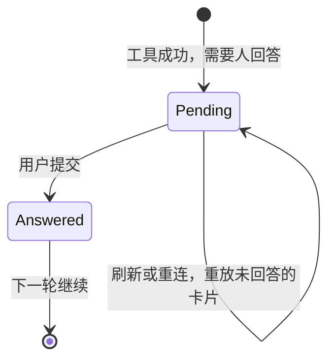
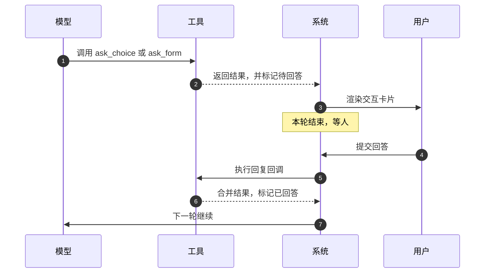

# Agent 怎么向人提问

> Agent 生产化手记 · 02
>
> **系列导读**：本系列尝试回答一个具体问题——当 Agent 不再是一次请求，而是一个可能持续几十分钟、会中断、会失败、要花钱、要被人看懂的有状态长事务时，生产系统该一条一条补上什么。
>
> - **第一篇**：能跑 10 分钟和能上线 10 个月，差在 Agent 是一笔有状态的长事务，上线就是把这笔事务该有的东西补齐。
> - **第二篇（本文）**：向人提问时，这一轮怎样提交成等待，刷新和隔天再答都还能接上。
> - **第三篇**：子 Agent 删了三次，因为它是另一笔事务，多数能力只是当前这一轮里的过程。
> - **第四篇**：接入和执行拆开，开单、回放和把这一轮跑完，不再绑在同一个进程上。
> - **第五篇**：事实、传输、恢复点、执行现场分开存，Checkpoint 不能当作数据库。
> - **第六篇**：成功、中断、取消、异常收成同一个提交点，执行不能靠重试再做一遍。
> - **第七篇**：254KB 的记忆怎样烧掉十几万 token，这笔预算取决于注入多少、何时注入、谁来写。
> - **第八篇**：轮次账本、租约、公平队列、能力评测、文档五处还没补上，现状离那句话还有多远。

七月的一个下午，用户点了"同意"。

Agent 说，好的，我来执行。然后 CLI 报错：确认码已过期。

它重新弹了一遍同样的确认框。用户又点。又过期。

用户忍不住问了一句："我不是已经点过了吗？"

我们翻日志，发现每一轮恢复命中的都不是眼前这张卡片，而是一个**早就回答完的旧表单**——它排在选择题前面，被当成"待回答"，于是选择题的回复逻辑从来没执行过，确认码也就从来没签发过。模型手里攥着一个几分钟前的旧码，一次次重试，一次次失败。

修完这一处，我们把整块交互推翻重写了一遍。

回头想，"让 Agent 问人一句话"这件事，比我们所有人一开始估计的都难。

---

## 一、为什么"问一句话"是系统级难题

普通软件里，弹窗是前端的事。后端给个接口，前端弹，用户点，前端再调接口。后端不关心这个框长什么样，也不关心用户什么时候点。

Agent 不一样。提问发生在图的中间，而这一轮是一个还没提交完的长事务。

模型调用工具，工具说"我需要用户回答"，然后这一轮结束。结束的不是任务，是这一轮：事务提交成"等待"。用户可能明天才回，进程可能先死，页面可能先刷新。等待期间，过程仍要能被重放。

所以问人不是弹窗，是长事务里"会中断"的一种合法终态。状态是 **pending → answered → resumed**：回答是下一次开单，从这条未回答的消息接着跑。它得有超时、有幂等、有回放、有审计。

*图 1：等待是这一轮的终态。恢复是下一轮从"已回答"接着跑。*

---

## 二、第一代：给"特殊"开个后门

六月底，内部系统的创建和执行需要用户确认。我们先把散落在各处的"要用户回答"的工具收进同一套机制——一个特殊工具中间件，加一张注册表，按工具名分发——然后加了 `ask_choice`。

做法很直接：给工具打上"特殊"的标记，中间件拦截，注册表里登记，每种特殊工具配一个适配器，负责把参数变成前端能渲染的卡片，再把用户的回答变回一条工具结果消息。

能跑。Demo 里看起来很顺。

问题是，这个设计把"等待"当成了**一类工具的属性**。每加一种交互——表单、计划、确认——就要动中间件、动注册表、动回放分支。到后来，光是 `ask_choice` 一个适配器就写了四百多行。

我们当时的判断是"特殊工具太多了，得管管"。后来才发现，真正的问题不是工具多，是**等待没有被当成终态**。它被安在工具类型上，每加一种交互就要改一条执行路径。

---

## 三、第二代：把等待变成工具上的一个布尔值

十月，我们重写了这一块。核心只有一句话：

> 等待不是一类工具，是工具执行成功后的一件事。

具体是三个改动。

工具的声明上加一个参数 `need_pending=True`。它不进模型的参数 schema，模型看不见，也填不了。

工具成功后，返回的结果消息被统一打上标记；每轮模型调用前，统一的检查发现标记，就结束这一轮。注意是**成功才等**——参数错了、执行失败了不等，直接把错误还给模型，让它自己改。等人之前先把能自己修的问题修完，这个细节省了我们很多无谓的交互。

用户下一轮提交时，每轮开始前的检查统一补全回复：找到最近一条未回答的卡片，执行它绑定的回复回调，把结果合并回原来那条消息，标记为已回答。

*图 2：一次提问的完整生命周期。注意"本轮结束"和"下一轮继续"之间，可以隔很久很久。*

新增一种交互，只要写一个交互子类，实现三个方法：

- 构建响应体：参数 → 卡片数据，不碰 IO；
- 处理回复：用户回答 → 业务动作（保存表单、签发确认码）；
- 保存文档：需要落文件时的统一出口。

中间件、注册表、回放分支都不用动。回放也不再依赖工具名——序列化层只看 payload 里的 `type`，旧记录里已经删掉的工具照样能渲染。

这次重写跑了一千多个回归测试。数字不重要，重要的是我们终于能把"等待"当成一个普通状态来处理，而不是一堆特例。

---

## 四、这一路踩过的五个坑

**坑一：提示词管不住模型，只能在执行侧拦。**

我们有一个内部命令行工具，它的创建和执行是危险操作。提示词里写得很清楚：必须先调 `ask_choice` 征求同意。模型有时候会跳过，直接跑。

你可以在提示词里加十个"必须"，它仍然可能跳过——因为提示词是建议，不是约束。

最后我们在选项上挂了一个 `command` 字段。用户选中某个选项后，系统用共享密钥对该命令签一个 HMAC-SHA256 的确认码，放在工具结果消息的顶层。CLI 执行前校验两件事：签名对不对、有没有过期。校验不过就拒绝。

有个细节挺有意思：最初有效期写的 60 秒，上线后发现根本不够——用户要看清楚、模型要想一会儿、CLI 还要启动。后来改成 600 秒。

安全边界放在执行侧，交互体验放在前端，提示词只负责"通常该怎么做"。这三件事必须分开。

**坑二：一张已回答的卡片，会劫持后面所有的轮次。**

这就是开头那个死循环。

系统倒着扫消息历史找"待回答的卡片"，但没检查这张卡片是不是已经回答过了；同时它按注册表顺序命中第一个匹配项。因为表单的注册项排在选择题前面，只要这个会话里出现过一次表单，之后每一轮都会命中它，然后短路返回。

结果就是：选择题的回复逻辑永远不执行，确认码永远不签发，模型拿着旧码反复重试。

修复不难：只认最近一条，而且必须未回答。但它暴露了一个更普遍的问题——**注册表的顺序是一种隐式契约**。没人写下来，没人测，出事的时候也没人会往那儿想。

**坑三：为了修一个洞去重写历史，会造出第二个洞。**

用户打断一轮，或者直接发了新消息，checkpoint 里会留下一次没有结果的工具调用。

我们最早的修法是：收尾时把整段历史重写一遍，补上占位。看起来很干净。

问题是，"重写历史"意味着整段历史会重新流经一遍消息流。特殊工具的那些结果消息被当成新消息，又下发了一遍。前端的表现就是：同一个确认框，弹一次，再弹一次，每轮都弹。

后来改成完全相反的做法：不动历史，只在下一轮开头，在尾部补一条占位消息。历史是只追加的，这个约束一旦破了，就会出现"两个版本的真相"。

**坑四：模型看到的工具说明，是内部实现的 docstring。**

有一段时间模型老传错参数。查下来发现：当参数 schema 和 docstring 解析同时开启时，框架会把 schema 的 docstring 当成工具描述，静默丢掉函数自己的 docstring。

也就是说，我们精心写给模型看的用法说明，它一个字都没看到；它看到的是"这是一个数据模型"。

工具描述是产品文档，不是注释。它需要被当成产品文档来测。

**坑五：只在实时路径里存在的行为，回放时一定会变成 bug。**

特殊工具刚好是最后一条消息时，被历史回放逻辑当成"没有内容"隐藏掉；工具通过控制流返回的结果，没有走正常的持久化路径，刷新之后就没了。

这些都不是大 bug，但每一个都会让用户觉得"你们系统不稳定"。而它们的共同点是：我们只在实时流里验证过，没在回放里验证过。

---

## 五、现在的样子

三种交互工具，共用一套生命周期：

| 工具 | 用途 | 回复时的动作 |
| --- | --- | --- |
| `ask_choice` | 单选、多选、带一个自由输入项 | 为选项里的命令签发确认码 |
| `ask_form` | 动态表单，一次收集多个字段 | 合并回答，写问答文件 |
| `plan` | 把执行计划交给用户审阅 | 回答进入下一轮上下文，不写文件 |

`plan` 一开始是会往沙箱写一个计划文件的。后来发现没必要——前端有计划卡片，模型也能从上下文里读到内容，写文件只是多了一个可能失效的副本。删掉之后，少了一类"文件和对话不一致"的问题。

最近我们还加了一个东西：**自动回答**。

开关打开后，卡片发出来不会停在等人，而是进一条消息队列，由 gateway 侧的消费者替用户作答。边界收得很死：只答 `ask_choice` 和 `plan`，`ask_form` 一律跳过，任何带 `command` 的高危选择题也一律跳过——机器可以替人点"好的"，但不能替人签字。

交互一旦是协议——谁发起、怎么渲染、回答长什么样、怎么续跑——另一个程序就可以扮演用户。自动回答是这件事的结果。高危确认不在协议的可代理范围内。

---

## 六、后来才想明白的四件事

**等待是一等状态，不是异常分支。** 别用"特殊工具"这种分类去承载它。它就是工具成功之后发生的一件事，属于执行流程，不属于工具类型。

**交互的边界是消息，不是 UI 组件。** 只要它最终落成一条能持久化、能回放、能标记为已回答的消息，它就能被恢复、被审计、被自动回答。反过来，如果交互只活在前端内存里，它一定会丢。

**安全必须在执行侧闭环。** 提示词负责"通常怎么做"，签名和校验负责"不许怎么做"。模型绕过提示词是常态，不是意外。

**回放要和实时同构。** 任何只在实时流里存在的分支，都是定时炸弹。这条我们后来写进了 review 清单：改交互，必须同时跑一遍刷新。

---

## 七、最后

现在回头看，长出来的不是三个弹窗，是这一轮的一种提交：模型发起，系统落成一条可持久化的等待消息，前端只负责渲染，用户的回答开启下一轮。

协议一旦成立，审批、计划、表单、自动回答、桌面端的高危确认，都是同一件事：中断要能落库、能回放、能被下一轮接上。

下一篇，我们聊一个相反方向的决定：**我们为什么把子 Agent 删了三次。**

---

*为保护项目与客户信息，文中系统名、工具名、业务场景和具体数值均做了抽象或区间化处理；技术结论不受影响。*
