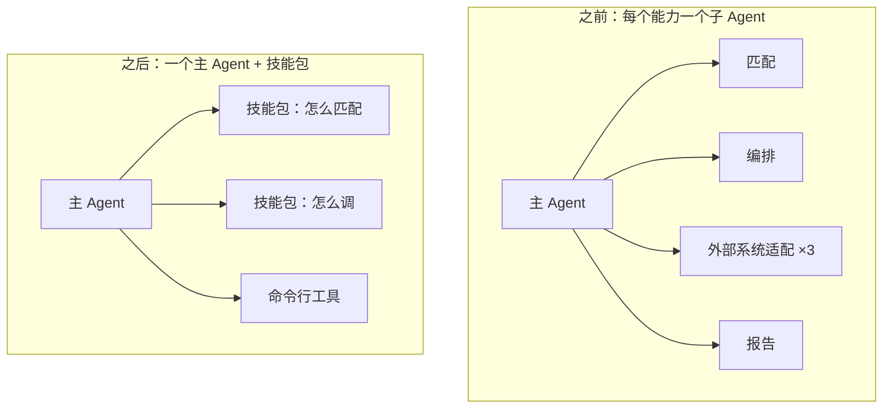

# 我们删了三次子 Agent

> **发布说明**：第三篇已发布至 `_agent/agent-from-0-to-1-part3.md`（`/agent/agent-from-0-to-1-part3/`），图表见 `assets/images/agent/agent-from-0-to-1/p3-01-subagent-to-skills.png`。
>
> Agent 生产化手记 · 03
>
> **系列导读**：本系列尝试回答一个具体问题——当 Agent 不再是一次请求，而是一个可能持续几十分钟、会中断、会失败、要花钱、要被人看懂的有状态长事务时，生产系统该一条一条补上什么。
>
> - **第一篇**：能跑 10 分钟和能上线 10 个月，差在 Agent 是一笔有状态的长事务，上线就是把这笔事务该有的东西补齐。
> - **第二篇**：向人提问时，这一轮怎样提交成等待，刷新和隔天再答都还能接上。
> - **第三篇（本文）**：子 Agent 删了三次，因为它是另一笔事务，多数能力只是当前这一轮里的过程。
> - **第四篇**：接入和执行拆开，开单、回放和把这一轮跑完，不再绑在同一个进程上。
> - **第五篇**：事实、传输、恢复点、执行现场分开存，Checkpoint 不能当作数据库。
> - **第六篇**：成功、中断、取消、异常收成同一个提交点，执行不能靠重试再做一遍。
> - **第七篇**：254KB 的记忆怎样烧掉十几万 token，这笔预算取决于注入多少、何时注入、谁来写。
> - **第八篇**：轮次账本、租约、公平队列、能力评测、文档五处还没补上，现状离那句话还有多远。

用户要跑一条内部流程，中间有一步需要他确认。

主 Agent 把任务派给子 Agent。子 Agent 跑到那一步，停住了——它不能问人。代码里有一条硬规则：子 Agent 不允许直接调用问人的工具。

于是它把问题写进结果里返回给主 Agent；主 Agent 读完，再去问用户；用户回答，主 Agent 再把答案派回去。

一次确认，绕了三圈。

这条规则不是 bug。子 Agent 是另一笔执行：它有自己的上下文，接不住主事务的中断点。问人只能发生在持有这一轮的那一边。

---

## 一、起点：上游的多 Agent 拓扑是对的

DeerFlow 自带一套多 Agent 结构：协调者、规划者、研究者、写代码的、写报告的。

这套结构放在"深度研究"这个任务上很合理。因为研究天然可拆：几个方向可以并行查，每个方向的中间过程都很脏（几十次搜索、一堆网页），但最后只要一段结论。子 Agent 在这里干的活，本质是**上下文压缩**——把脏活关在一个独立上下文里，只把干净的结论带回来。

我们继承了这个拓扑，也继承了它的假设：任务可拆、可并行、结果可压缩。

上游那套分工之所以成立，是因为每层都有独立的输入输出：规划者产出一份提纲，研究者按提纲逐条查，报告者只读提纲和结论。层与层之间传的是结构化产物，不是对话。

问题在于，后来我们做的不是研究。

---

## 二、第一次照搬：给每个业务能力配一个子 Agent

做业务 Agent 时，我们照着上游的样子画了一张图：

匹配需求的 Agent → 编排流程的 Agent → 调用外部系统的 Agent（好几个）→ 出报告的 Agent。

一张图五六层，看起来很专业。

当时的想法很简单：每个能力一个 Agent，职责清晰，提示词也短。设计文档里甚至写了一条规则——"调用子 Agent 的动作应该由主 Agent 来做，子 Agent 只提供建议"。现在回头看，那条规则其实是在绕开"子 Agent 不能问人"这个限制。

而且框架把这件事做得太顺手：加一个配置块、写一段提示词，就多一个 Agent。加一层几乎不要成本，于是你就会加。

这是第一个陷阱——**当增加一层几乎免费时，你一定会增加它。**

---

## 三、第一次删（5 月）：薄封装不是 Agent

真正跑起来才发现，这五个子 Agent，每个只做一件事：调用一个脚本。

提示词很短，工具就一两个。它的全部工作就是"把参数传给脚本，把输出带回来"。

这不是 Agent，是函数。

5 月我们把它们删了：五份提示词，两百多行，主 Agent 直接用命令行工具执行脚本。系统里少了一层委派，也少了一层"参数传错、结果丢字段"的故障面。

调用链也从"主 Agent 派发 → 子 Agent 调脚本 → 结果回传"变成了一条直线：读说明、执行、回报。中间出错时，错误就在同一条消息流里。

留下的判断是：**如果一个子 Agent 的全部工作是调用一个脚本，那它不该存在。**

---

## 四、第二次删（7 月）：流程匹配是技能，不是 Agent

第二次在另一条业务线。它的子 Agent 负责"根据用户描述匹配流程模板，然后调用"。

听上去像一个独立能力，实际拆开是三步：检索模板、提取参数、调脚本。三步都不需要独立上下文，也不需要并行。

我们把它改成了一个技能包：一份 SKILL.md 说明怎么匹配、怎么调，主 Agent 自己读、自己执行。

改完之后有三个直接好处：少一份提示词要维护；技能包可以热更新，不用发版；技能可以按用户开关，子 Agent 不行。

还有一个不那么明显的好处：技能是模型自己决定什么时候加载的。子 Agent 不行——派不派、派给谁，是主 Agent 在看到结果之前就得决定的事。

---

## 五、第三次删（9 月）：业务知识是技能，不是 Agent

第三次规模最大。六个业务域各有一个子 Agent，每个都带着一整套业务说明——术语、判断规则、常见错误。

可这些内容是**知识**，不是**任务**。知识应该给模型读，任务才需要派发。

判断方法很土：这段内容，你愿意让它每轮对话都出现吗？愿意，它是知识；只在特定任务里出现、还要模型自己做决定，它才是任务。

我们把六个子 Agent 的提示词抽成了六个公开技能包，主 Agent 判断业务域后加载对应的 SKILL.md 自己执行。子 Agent 从"业务专家"退回成"通用助手"。

同一个月，我们还删了另一层东西：自研的子 Agent 基础设施——`task` 工具、执行器，以及一整套 `task_started / task_running / task_completed` 事件。

那套事件协议我们做了不少工作，前端一次都没对接过。

也就是说，我们为"用户看不见的过程"建了一条完整的观测通道，然后发现没人要看。

删执行器比删提示词难。那套东西里有线程池、有 `Future.result(timeout)` 的硬超时、有一张进程内的任务表。硬超时看起来很稳，但取消语义是错的：超时只是让调用方不再等，子 Agent 还在跑。

最后我们把它换成"整轮超时 + 外部硬取消"——超时归一轮管，不归一个子任务管。

*图 1：左边是照搬来的拓扑，右边是删完之后的样子。*

---

## 六、子 Agent 的三个真实成本

删了三次之后，我们才把成本算清楚。

**第一，上下文断裂是双向的。** 子 Agent 看不到主对话的历史，主 Agent 也看不到子 Agent 的中间过程——只拿回一段最终结果。任务简单时这是优点，省 token；任务复杂时这是灾难，主 Agent 不知道它为什么失败，只能重派一次。

更麻烦的是复盘。主 Agent 只拿到一段"已完成"，不知道它读了哪些文件、改了什么。要查清楚，得把两层的 trace 拼起来看。

**第二，它不能问人。** 问人这条链路进了子 Agent 就断了。而业务里大量步骤是"需要确认"的：跑不跑、用哪个模板、参数对不对。这些确认只能回到主 Agent 做，于是就有了开头那个绕三圈的场景。

这不是产品选择，是结构问题。"问人"意味着在图中间暂停，而暂停点属于整张图；子 Agent 是图里的一段子流程，它的暂停该由谁恢复、恢复到哪，没有干净的答案。

我们试过让子 Agent 只返回"我需要问什么"，再由主 Agent 代问——结果就是开头那个绕三圈。

**第三，维护是双份的。** 提示词一份、工具白名单一份、技能引用一份。主 Agent 改一条规则，子 Agent 那边要同步；工具名还得单独映射，因为框架的工具名和业务工具名是两套。

---

## 七、那什么时候真的需要子 Agent

不是不用，是条件很苛刻。我们现在只认三条：

1. **中间过程确实会污染主上下文。** 比如一次搜索要读几十个网页，主 Agent 只需要结论。
2. **可以并行。** 三个方向同时探索，或者一边跑构建一边读代码。
3. **结果能压缩成一段话。** 如果返回的是一串需要用户逐条确认的操作，那它不该在子 Agent 里做。

三条都满足，才值得多一层。只满足一条，通常是给自己找麻烦。

反过来，有些任务看起来像并行，其实不是。比如同时问五个业务域的问题——看起来可以开五个子 Agent 各查各的，但它们读的是同一份知识、查的是同一个系统，并行只会让五份中间结果互相重复。这种"伪并行"是我们踩得最多的坑。

我们现在有个很土的标准：**这件事如果用人话跟一个同事说一遍，他就能干完，那不需要子 Agent；如果他会反问你三个问题，那更不该给子 Agent。**

现在系统里只剩两个通用子 Agent：一个做探索，一个跑长命令。并发数设成 1——因为我们发现，真正需要并行的场景，比想象中少得多。

---

## 八、最后

还有一个规律：三次删除都不是在"清理技术债"的时候发生的，而是在开新产品、接新业务的时候。平时没人有动力去删一个还能跑的东西，只有当你不得不在它上面再搭一层时，才会发现那一层是多余的。

回头看，三次删除是同一笔账的三次确认：

**子 Agent 不是架构升级，是另开一笔长事务。** 它自带状态、上下文账单和失败域，还接不住"问人"这个中断。上下文隔离开来，是付这笔账的唯一理由：中间过程会弄脏主上下文，任务可以并行，结果能压成一段话。三条都在，才值得开。少一条，它就是一个更贵的函数。

下一篇，我们聊另一个"看起来必须存在、其实可以拆掉"的东西：**框架的运行时。**

---

*为保护项目与客户信息，文中系统名、工具名、业务场景和具体数值均做了抽象或区间化处理；技术结论不受影响。*
