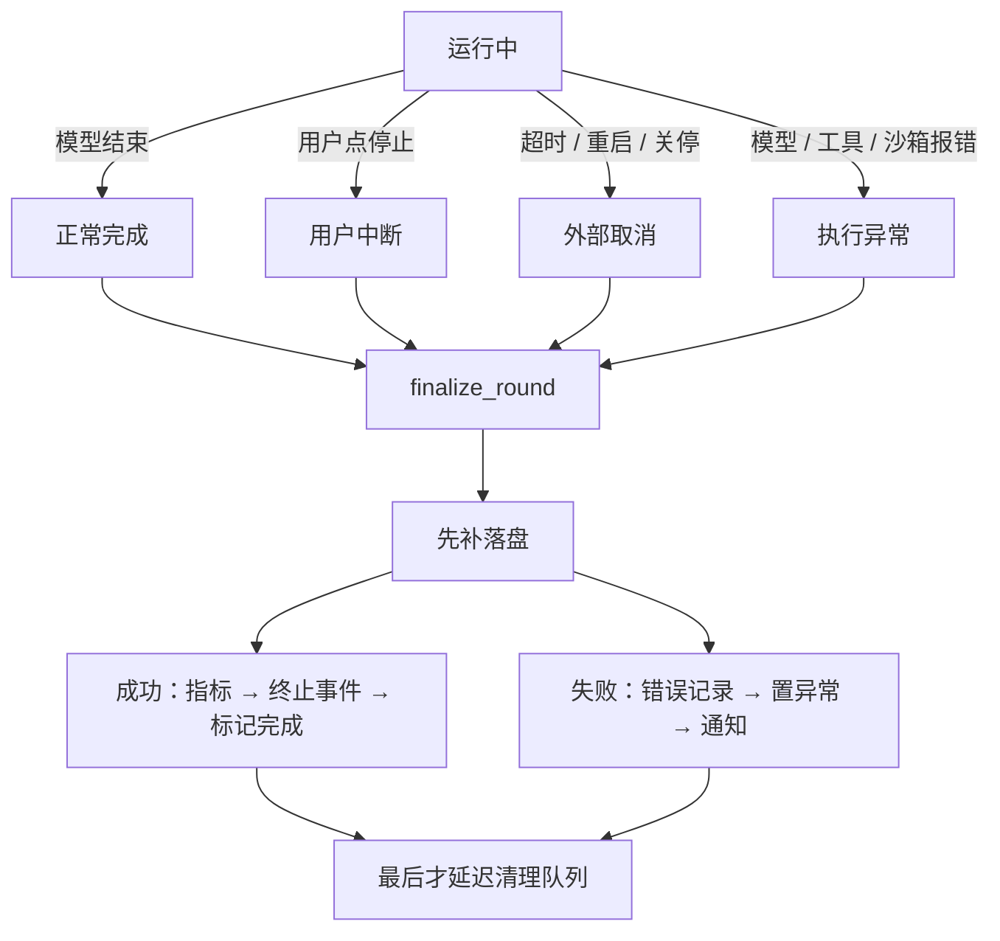

# 一百三十个 bug 之后：Agent 轮次的四种死法

> Agent 生产化手记 · 06
>
> **系列导读**：本系列尝试回答一个具体问题——当 Agent 不再是一次请求，而是一个可能持续几十分钟、会中断、会失败、要花钱、要被人看懂的有状态长事务时，生产系统该一条一条补上什么。
>
> - **第一篇**：能跑 10 分钟和能上线 10 个月，差在 Agent 是一笔有状态的长事务，上线就是把这笔事务该有的东西补齐。
> - **第二篇**：向人提问时，这一轮怎样提交成等待，刷新和隔天再答都还能接上。
> - **第三篇**：子 Agent 删了三次，因为它是另一笔事务，多数能力只是当前这一轮里的过程。
> - **第四篇**：接入和执行拆开，开单、回放和把这一轮跑完，不再绑在同一个进程上。
> - **第五篇**：事实、传输、恢复点、执行现场分开存，Checkpoint 不能当作数据库。
> - **第六篇（本文）**：成功、中断、取消、异常收成同一个提交点，执行不能靠重试再做一遍。
> - **第七篇**：254KB 的记忆怎样烧掉十几万 token，这笔预算取决于注入多少、何时注入、谁来写。
> - **第八篇**：轮次账本、租约、公平队列、能力评测、文档五处还没补上，现状离那句话还有多远。

有个会话，每一轮都失败，失败原因都一样。

用户重试了七次，我们重启了两次服务，它还在失败。

上一轮被取消时，模型已经发出了工具调用，结果还没回来。修复逻辑在收尾时把整段历史重写了一遍，补上一条占位。这条占位长得像一张还在等回答的卡片。下一轮按卡片去解析它，对一段纯文本做 JSON 解析，崩了。异常结束又走进同一段修复，再重写一遍。每修一次，checkpoint 里就多留一个错误形态。

重启换的是进程。病原在上一轮写下的数据里，下一轮会把它再读出来。

这不是"一个 bug 修了七次"。是这一轮没有一个干净的死法，修复动作自己又变成了下一轮的输入。

---

## 一、一轮对话有四种死法

请求失败，返回一个错误就结束了。一轮对话不是这样。它可能已经写了一半消息、扣了一部分积分、在队列里留着还没读完的输出。停下来的时候，这些都得有个说法。

不等人的结束，我们见过四种。等人是另一种终态：工具成功，这一轮提交成"等待"，回答算下一轮（第二篇）。下面说的是等待之外，一轮怎样停。

| 死法 | 谁触发 | 用户看见什么 | 账上必须留下什么 |
| --- | --- | --- | --- |
| 正常完成 | 模型自己结束 | 结果、耗时、积分 | 指标、终止事件、完成状态 |
| 用户中断 | 点"停止" | 已经流出的内容，加一个中断标记 | 半成品落库、中断标记、完成状态 |
| 外部取消 | 超时、重启、关停 | 同样的内容，加一条"服务异常" | 错误记录、异常状态、可重放的错误事件 |
| 执行异常 | 模型、工具、沙箱报错 | 一条错误事件，能重试 | 稳定错误码、异常状态、同一条错误事件 |

成功也在这张表里。正常完成如果不写指标、不发终止、不清理队列，客户端就不知道这轮已经结束，界面会一直转。四种看着像四种收尾，其实是四套结束语义，都要提交。

第一版在每个能结束的地方各写一段：

```python
try:
    await stream()
    await write_metrics()
    await notify()
    await mark_complete()          # 只有正常路径走到这
except CancelledError:
    await notify()                 # 忘了 mark_complete
except Exception:
    await mark_error()             # 忘了清理队列
```

用户看到的症状对得上漏掉的那一步：

- 没发终止事件：内容都收到了，界面还在转。
- 没补落盘：当时屏幕上有字，一刷新就没了。
- 没写错误记录：进程已经死了，刷新之后像正常结束，只是没有内容。
- 队列清早了：还在读的那一端突然断流。

顺序也不一样。有的路径先标记完成再写指标，客户端拿到完成信号立刻重连，读到的是还没写完的耗时和积分。

---

## 二、收敛成一个入口

后来收尾拆成三个可以拼起来的单元：

- **补落盘**：把已经流出来、还没进数据库的内容补上。这一步失败就吞掉，不再往上抛。字已经给用户看过了，补不上也不能把整个收尾带崩。
- **成功定稿**：写指标和积分，发终止事件（带上总轮数，给客户端当下一次的 offset），标记完成，再延迟清理队列。
- **失败定稿**：写一条带稳定错误码的错误记录，把状态置成异常，通知，延迟清理。

四个状态就是这三块的不同拼法。用户中断走补落盘加成功定稿，多一个中断标记。外部取消和执行异常走补落盘加失败定稿，错误文案不同。正常完成不需要错误记录，但终止事件一张都不能少。



*图 1：四种死法进同一个函数。差别在拼哪几个单元，不在各自再写一套收尾。*

所有路径最后都调这一个函数。新增一种结束方式，不用再找遍每个 `except`。四份副本上最常见的事故，就是其中一份漏了一步，另外三份看起来都是好的。

顺序有两处不能换，都是客户端的行为逼出来的。

**标记完成必须在指标之后。** 客户端一看到完成就会重连，按新的 offset 去读这一轮的耗时和积分。标记如果先到，它读到的是残缺的一行。

**清理队列必须再靠后，而且要延迟。** 第五篇那条传输日志是只追加的，人可能还在读。清早了，后半段补不回来；终止事件也要从这条日志里送到还连着的那一端。

外部取消里最常见的是超时。单轮上限一开始是 1 小时。实测有一轮跑了 61 分钟，到点被硬杀，用户等到最后，什么都没拿到，也没有第二次执行——队列不会把这一轮再跑一遍。上限后来改成 2 小时。超时在这个系统里是判决，不是"到点再试一次"。

收尾因此也不重试执行本身。一轮里已经发生的副作用包括消息、积分、记忆、产物文件。再跑一遍，这些就再做一遍；两个执行者还会互踩心跳、各写各的收尾。任务 id 用的是轮次号（第四篇），同一个号再投一次，队列会当成已经存在，静默丢掉。想重做，得开新的一轮，走新的提交，不能把旧的死法伪装成一次重试。

> 回放可以重复，那是把已经发生的记录再读给人。执行不能重试，那是再产生一次副作用。

---

## 三、五个真实故障

入口收成一个之后，剩下的故障都是这个提交点没接住的边。五个都在线上出现过。

**第一，悬空的工具调用会每轮复发。**

模型发出一批工具调用之后，框架要逐个跑完、逐个把结果填回去，再整批提交进 checkpoint。用户点停止，或者直接发来新消息把这一轮换掉，经常落在"调用已经写下、结果还没回来"的窗口里。checkpoint 里就剩一条带工具调用、却没有任何结果的模型消息。下一轮把这份历史发给模型，请求会被直接拒绝：每个调用都必须有恰好一个结果。

最早的修法是在取消收尾时重写整段历史，删掉尾部，补上占位。第二篇写过它的一个可见后果：整段历史重新流过消息流，特殊工具的结果被当成新消息又发了一遍，前端把同一个确认框弹了一次又一次。

还有一个更狠的后果，就是开头那个会话。占位按通用结构合成，恢复逻辑分不清它和"正在等用户回答的卡片"。它按卡片去解析，JSON 解析失败，整轮异常结束。异常和取消走同一段收尾，修复再跑一遍。用户重试七次，就是把这条回路喂了七次。

后来改成反方向。取消的那一刻不改历史，只把已经流出来的内容补上，把状态记成中断。悬空留在 checkpoint 里。下一轮真正开始、上一轮已经尘埃落定之后，在用户的新消息之前补一条配对。历史只追加，不出现第二个版本。

等人的那类工具还有一个产品上的差别。用户没填表单，点了停止，然后打了一句"用默认的"。这条新消息就该算那张卡片的回答，形态和正常挂起之后再答一样。命令没跑完、文件没写完，就记成失败。硬编一个成功结果，是向模型撒谎。

**第二，两处同时写消息，序号会撞车。**

模型回复是流式过程中逐条落库的，收尾时还要补写没落上的那一段。两边都用"读出当前最大序号，加一"来编号。并发的时候读到同一个最大值，后插入的那条撞上唯一键。没有抛给用户的错误，账本上就是缺了一行。刷新之后，像是模型那句话没说过。

修复是同一会话的序号放进数据库的事务锁里，串行分配。同一会话的消息本来就有顺序，串行写是这个顺序本来的代价。

**第三，终止事件被前面的异常吃掉。**

收尾要写指标、积分、记忆，还要通知前端。这些步骤只要有一个抛异常，后面的"标记完成"就进不去。客户端的逻辑是：等到完成标记，这一轮才算停。所以表现稳定地是同一种——内容都在，圈还在转。

修复很土：结束信号放进 `finally`。指标和积分能写就写，而且要写在标记之前，好让重连读到最终值。但标记本身不能是"前面都成功才执行"的一步。前面失败了，这一轮更需要一个终态，不然用户连失败都等不到。

**第四，假死回收之后，刷新像是正常结束。**

进程被 kill、容器被驱逐、发布重启，收尾不会跑。会话停在"运行中"，前端等一个已经不在的执行者。第五篇的巡检负责把这种会话收成异常：心跳没了，再对照最近落库的消息，确认没有人还在写，才改状态。

第一版巡检只改状态，不写错误行。回放读的是消息表，不是那个状态位。表里没有失败，客户端就把它画成"这一轮正常结束了，只是没有内容"。

修复是让巡检和 worker 自己的失败走同一个出口：补一条错误记录，写两次落在同一行，回放时在同一位置重放一条错误事件。状态说了失败，账本里也得查得到这件事。

**第五，新消息把队列换掉了，旧轮还在烧钱。**

同一个会话又发来一条消息，旧轮的队列会被删掉，新轮另起一条。旧轮的 worker 不知道。它继续跑模型、继续往一个已经不存在的队列里写 chunk。用户这边什么都看不见，账单还在走，日志里反复是"队列不存在"。

两道检查。执行真正开始之前看一眼队列还在不在，不在就跳过，图都不用建。跑起来之后看门狗每秒再看一眼，队列没了就硬取消，走进上面那个外部取消的出口，而不是在一个无人接收的队列上把这轮跑完。

---

## 四、三条不变量

可靠性这块，现在只守三条。

1. **收尾只有一个入口。** 任何结束路径都经过它。别的地方可以发起结束，不可以自己补状态、自己发终止、自己清队列。
2. **结束信号放在 finally。** 它可以是最后一步，不能是"成功才执行"的一步。
3. **错误必须落库，并且能被重放。** 用户刷新之后看到的历史，要和当时发生的一样，包括失败。

第三条最容易被丢掉。有一阵我们觉得错误是运行时的事，历史只存模型说过的内容。结果就是刷新之后，一次失败看起来像一次正常的空白结束。第五篇把"人看见的事实"放进消息表之后，这条才有地方落地：回放不读 checkpoint，失败如果不在消息表里，就等于没发生过。

配套的是错误码。每种失败归成一个稳定的 code，加一句给人看的文案。原始异常、堆栈，只进日志。前端按 code 分支：这一轮可以重试，还是该换模型，还是该去看沙箱。没有这个区分，四种死法到了界面上都是同一句"服务异常"，用户不知道下一步该做什么，我们也不知道该先查哪一层。

---

## 五、一百三十多个 fix 换来的是出口

最近两个多月，一百三十多个提交是在修 bug。修之前，这些失败多数没有终态。进程被杀，会话一直转圈。并发写丢一条消息，看起来像模型没回。取消时重写历史，下一轮用上一轮的残骸再崩一次。

这些提交分散看，是消息、队列、心跳、回放各自的补丁。收在一起，都是在补同一个洞：这一轮停了，但没有提交。

现在失败会在分钟级里写成异常，并且能被回放。分钟级来自心跳和巡检的余量（第五篇），不是来自把执行再跑一遍。检测可以晚一点，终态不能没有。

可靠性不是没有 bug。是每种结束都经过同一个提交点，失败和成功一样能被人看见：已经做成了什么，停在哪一步，能不能另开一轮接着来。

---

## 六、最后

这一篇补的是长事务里的"会失败"。失败要落成明确的终态，收尾就是提交点。

成功、用户中断、外部取消、执行异常，四种走同一个函数。请求失败了，返回错误就结束。这一轮失败了，还得让人看见失败在哪一步、已经做了什么、能不能接着来。

下一篇换个更贵的东西：**上下文。** 一轮能干净地死去之后，下一轮还会把上一轮留下来的东西再读进去。读进去多少，就是下一轮的账单。

---

*为保护项目与客户信息，文中系统名、工具名、业务场景和具体数值均做了抽象或区间化处理；技术结论不受影响。*
