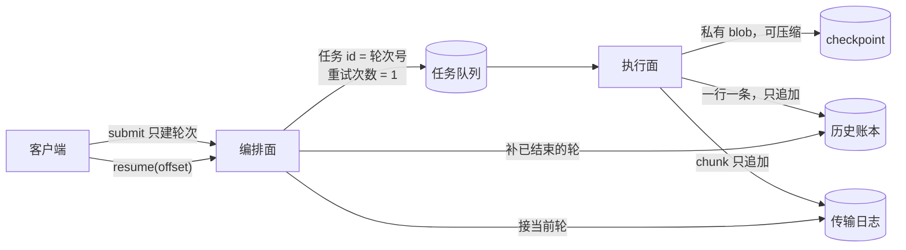
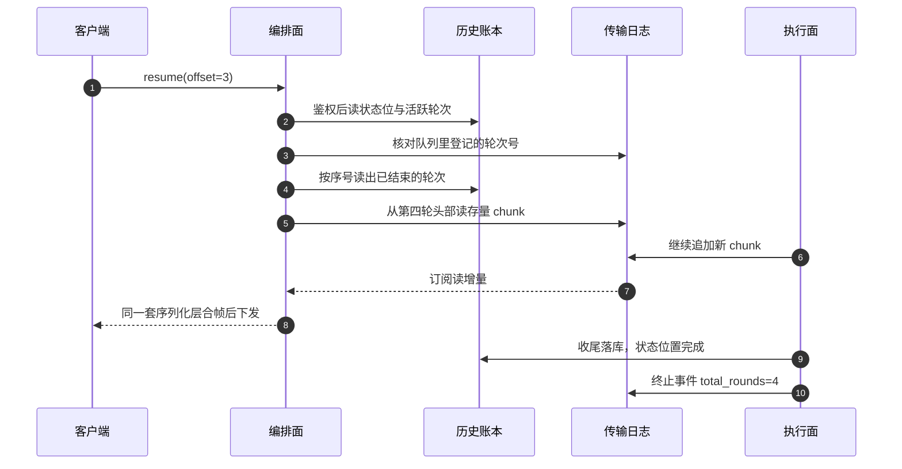

# 两场分离：把一个能跑的 Agent 拆成能运维的平台

> Agent 平台改造实录 · 02（全八篇）
>
> 这个系列复盘我们在一个生产 Agent 平台上的几场关键改造。它们都发生在模型外围的那一层——业内现在叫它 **Agent Harness**：agent 循环、工具调用协议、上下文与能力供给、沙箱执行、状态恢复，把一个"会说话的模型"变成"能干活的系统"的全部夹具。这里的题目从来不是让模型变强，而是让这层夹具能上线、能运维、能长大。八篇从模型身边一圈圈长出去，直到整个平台：
>
> - **01**：能力供给——技能体系的三次搬家与四代检索。
> - **02（本文）**：状态与账本——编排/执行分进程、历史/运行态分存储的两场分离。
> - **03**：行动协议——未配对的 tool_call 会每轮复发，参数也会在共享额度里被截断。
> - **04**：执行环境——沙箱的粒度、归属与休眠。
> - **05**：监督交互——把"向用户提问"做成一等协议。
> - **06**：上下文纵深——给 Agent 装记忆的三次返工。
> - **07**：运行时自身——性能与判活。共享线程上的阻塞会停住全部轮次，判活不能只信一把会过期的 key。
> - **08**：收官——还没解决的问题，与生产型 Harness 检查清单。
>
> 写法上尽量回到第一性原理：不罗列"我们做了什么"，而是推演"约束是什么、为什么只有这一条路"。所有案例真实发生，系统与数值已做脱敏。

那天晚上的发布，重启用了三秒。

三秒之后，所有正在输出的会话一起消失。前端转圈，直到超时。日志里没有异常栈——能写异常栈的那个进程，就是被重启杀掉的进程。

复盘结论只有一句：LLM 的执行循环跑在 API 进程里。重启 API，等于把所有在途的长事务一起杀掉。系统当时已经上线几个月。

这篇文章讲此后的两场分离。第一场把编排和执行拆成两个进程，第二场把历史账本和运行时恢复点拆成两套存储。它们各自都能从一条物理约束推出来；推完会发现，约束是同一条：

> **两样东西的重启半径不同，或读者不同，或退化模式不同，就不能住在一起。**

先看终态。后面每一节都是这张图的一个局部，以及我们为了让它成立付出的协议。

*图 1：两场分离的终态。编排面只碰 HTTP、账本和日志，不碰执行框架的内部对象；checkpoint 只回答"图从哪继续"，不回答"人看见了什么"。*

---

## 一、第一场分离：编排和执行，是两种不相容的负载

### 执行框架默认的三件事

执行框架自带的运行时，在 demo 里很顺，因为它默认了三件事：

1. 一次会话，对应一条流式连接；
2. 状态，存在框架的 checkpointer 里；
3. 执行就在这个进程里——进程活着，会话就活着。

这三条在"一个人、一个浏览器、不刷新"时成立。对外之后挨个碎掉。用户一刷新，连接断了，还在进程内存里的事件就没了。服务一重启，正在跑的那一轮没了。想加副本，发现订阅状态绑在这一个进程上，加不了。

我们的第一反应是把循环留在 API 进程里，用一个进程内任务跑完它。本地调试很舒服：一个容器，断点能一路跟下去。舒服的代价写在开头那次发布里——API 的重启半径，成了每一轮对话的重启半径。

把负载摊开，冲突是结构性的。

**编排面**接 HTTP、鉴权、限流、建会话、回放。毫秒级，连接来了就走，发布频繁。

**执行面**跑 agent 循环。一轮对话是几十到几百次"模型 → 工具 → 模型"，持续几分钟到两小时。有状态（图停在某一步），长生命周期，对重启零容忍。

| | 编排面 | 执行面 |
| --- | --- | --- |
| 一次调用要多久 | 毫秒 | 几分钟到两小时 |
| 扩容跟着什么走 | 连接数 | 在途轮次 |
| 进程里有什么 | HTTP、数据库客户端、队列客户端 | 执行框架、工具、科研计算依赖 |
| 重启意味着什么 | 一次正常发布 | 在途事务被杀 |

三条冲突都是算术，不需要品味：

- **重启半径。** 编排面要经常重启，执行面一次都不该被重启。放进同一个进程，前者的正常操作就是后者的事故。
- **扩容曲线。** 绑在一起，要么按执行面一起扩（编排面的副本背着它用不上的依赖），要么不能扩（执行面把连接占满，连拉历史的请求都进不来）。两边的单位成本差一个数量级：编排进程是轻的，执行进程的镜像是 GB 级的。
- **故障域。** 一次模型调用的内存泄漏、一个工具死循环，会拖死同一进程里所有连接，包括只想看一眼历史列表的人。

结论：**两类负载的重启半径不同，就必须分进程。** 分完之后，真正要设计的是三条缝：任务怎么投过去，流怎么传回来，代码还许不许互相 import。

### 投递：队列的默认契约，这里一条都不能用

执行任务放进基于 Redis 的任务队列。看起来是标准动作。标准动作默认三件事：任务没有副作用、失败了可以重试、任务 id 随机生成。发邮件时这三条都成立。一轮 agent 执行里，三条都要改掉。"取走即删"是第四条默认，它死在下一节的回传里。

**任务 id 直接用轮次号。** 一轮在编排面登记时就分配全局唯一的轮次 id，入队时拿它当任务 id。同一次轮次因为网络重试、双击、上游重发被入队两次，队列里仍然只有一条。幂等挡在投递协议上，每个消费方不用再各写一遍。

这条决定有一个必须一起记住的背面：**想重跑同一轮，必须换一个新的轮次号。** 沿用旧号，队列认为这单已经存在，投递被静默丢掉——调用方看到的是"我发出去了"，执行面什么都没发生。幂等键的代价，是"重做"不能伪装成"再投一次"。

**重试次数设为一。** 一轮执行的副作用包括消息落库、积分扣减、记忆写入、产物文件。重跑一遍，这些就再做一遍。更坏的形态是两个执行者同时跑同一轮：心跳互相覆盖、收尾各写各的、计费记两笔。故障从"这一轮失败了"升级成"系统行为对不上任何一条日志"。

所以有一条比实现更硬的原则：

> **回放可以重复，执行不能重试。**

回放是把已经发生的记录再读给人，读多少遍都只是读。执行是再产生一次副作用。宁可这一轮失败，由收尾把终态写清楚（收尾在第七篇），也不要让队列擅自再跑一次。

不重试立刻改写超时。单轮上限一开始是一小时，实测有一轮跑了六十一分钟，被硬杀掉，用户等到最后什么都没拿到，也没有第二次机会。上限改成两小时。**不重试的系统里，超时就是这一轮的结束，不是可以重试的保护线。** 上限卡得太紧，一轮到点就结束，没有下一次。

**信封只有三段：`{类型键, 载荷, trace_id}`。** 载荷是纯 JSON。执行框架的运行时对象——中断点、内存里的图、不可序列化的句柄——不许出现在信封里。worker 按类型键查注册表分发，新增一种任务是注册一行，分发入口不再长分支。trace_id 在编排面生成，日志从 API 透传到 worker。一次提交在编排面大约十几行、执行面大约三十行，靠这一个 id 收成一条链路。

这三条改完，队列还剩下的默认行为只剩"把字节从这边搬到那边"。机制收敛在唯一一处，业务类型可以继续加。

早期配置里留过一条旁路：任务不进队列，直接在编排进程里跑，方便本地调试。后来删了。两条路径意味着同一段逻辑有两个执行环境，每个 bug 都要先回答"是哪条路径"。只在线上路径出现的那部分，旁路永远测不到。调试用专门的调试栈，生产代码里只留一条执行路径。

### 回传：流不能属于某一条连接

执行面吐出的正文、思维链、工具调用，不能 HTTP 回调回编排面。编排面是多实例的，回调打给谁？用户的下一次连接，大概率不在原来那台机器上。

也不能做成"取走即删"的队列。取走的那一个读者把消息消费掉之后，刷新页面的同一个人、同时打开的另一个端，都看不到已经发生的前半段。

所以传输日志做成**只追加的广播**：worker 把输出逐条写进 Redis，消息不因被读过而删除，每个读者自己记读指针。编排面从日志里取出，转成 SSE。晚到的读者从自己的指针补，补完再跟上新到达的。

当时这只是一个实现选择。它后来成为断线重连、刷新、多端同看的同一条机制——三者都是"把正在发生的流，从某一条具体连接里解耦出来"。第二场分离会把这个选择升级成契约。这里先记住它的数据形状：日志是一份可重放的记录，读者是无状态的。

提交接口也跟着改了形状。`submit` 的响应里没有模型输出。它只建这一轮：鉴权、分配轮次号、登记这一轮的日志、把用户消息写入账本、把任务入队，然后毫秒级返回。正文一律从 `resume` 读。接口看起来绕，它同时解决了上面那三件事。内容若从 `submit` 的那条 HTTP 响应里流出来，这条响应一断，后面的输出就没有另一处可以读。

### 比进程更难分的，是 import

进程分了，镜像还是一家人。编排面为了回放历史，import 了执行侧的模块。后果是两个镜像互相拖带：改一行执行代码，编排镜像要重建；执行侧的科研计算依赖把编排镜像撑到 GB 级，构建以十分钟计。打开那个号称"只做 API"的镜像，里面是整套执行框架。

进程边界分开了，依赖边界没有分开。发布耦合从"同一个进程"变成了"同一批镜像"。

解法是把"编排 → 执行零 import"写成可执行的检查，而不是约定。脚本扫编排代码，发现任何一处 import 执行侧模块，就拒绝合并。更硬的验收在镜像里：编排镜像能 import 接入框架，import 执行框架必须失败；执行镜像反过来。目录拆开而依赖没拆，只有这一下会响。

切割是渐进的，每一步都能单独验收：

1. **试点。** 最小的反射工具模块迁到共享库。两三个文件，没有业务逻辑，用来验证搬迁流程和检查脚本本身。
2. **配置层。** 配置解析两边都要用，归共享库。
3. **沙箱接口平级化。** 类型定义从执行侧的包里提出来，与编排、执行平级。编排面要给桌面客户端做设备管理，需要沙箱的类型，不需要沙箱的实现。
4. **中断。** 这是最后一处还指向执行侧的依赖。"中断会话"原来长在执行侧，因为实现就是"取消那个执行循环"，而循环在 worker 里。放错了位置：中断是控制面动作，只是曾经能直接调用执行面内部的函数。改成编排面写一个取消标志，执行面在循环间隙看见标志，自己取消自己。编排面不再调用执行面的函数，import 就归零了。

取消的可观察结果是"标志被看到"，不是"那个函数返回了"。进程如果已经死了，标志没有读者，这一轮不会自己结束——那是第七篇巡检要补的窗口。这一步只负责把控制面动作搬出执行面的地址空间。

这件事的产出不只是零个 import。依赖方向可以被审查、被度量、被归零。它是每一次"顺手 import 一下"攒出来的，也是可以按这个方向拆回去的。

### 第一场分离的结果，和当天就出现的成本

- `submit` 毫秒级返回，HTTP 不再被模型拖住；
- 执行侧独立容器、独立扩容，单 worker 的并发轮次从个位数到三位数；
- 验收标准就一条：**发布编排面，不再杀死任何在途会话。**

成本也是当天就出现的。一次请求的日志拆在两个容器里，没有共同的 trace_id 就对不起来。本地要把两个进程真的连起来跑。发布要保证两边对信封的理解兼容。

还有一类 bug 只在分进程之后存在。队列名在模块加载时从环境变量读，两个进程各记下自己那一份默认值，消息进了一条没有消费者的队列。单进程里不会出现，单测也触发不了。架构图上看，队列只有一个；运行时有两个，因为名字在 import 的那一瞬间已经分成两份。

---

## 二、第二场分离：历史不是 checkpoint

### 零 import 之后，还剩一条读路径

进程和依赖拆完，编排面仍在最核心的读路径上碰执行框架：用户断线重连、刷新页面时，回放读的是 checkpointer。那是框架为"从断点继续跑图"准备的状态存储。编排面口头上对执行零依赖，实际上必须懂它的私有结构，还要持有那份存储的读权限。

要判断这是不是错，先看读者。系统里其实有三份"发生过什么"，读者各不相同。

| | 历史账本 | checkpoint | 传输日志 |
| --- | --- | --- | --- |
| 谁在读 | 人、审计、计费、回放 | 执行框架自己 | 正在看屏幕的连接 |
| 形态 | 消息表，一行一条 | 私有格式的完整 blob | 当前这一轮的 chunk 序列 |
| 怎么长大 | 只追加，可按会话和序号查 | 随消息数线性增长，整份读写 | 只覆盖在途的一轮 |
| 允许的退化 | 慢 | 被压缩、被裁剪、原文换成摘要 | 到期消失 |
| 禁止的退化 | 改写已经写下的原文 | — | 被某一个读者消费掉 |

checkpoint 的读者只需要"足够把图继续跑下去"。为了不撑爆上下文，框架会在中途压缩：旧对话收成摘要，原文从 blob 里消失。这对运行时是有意的。把它当成人看见的历史，压缩一旦发生，用户看到的对话和模型记得的对话就对不上，而且你无法向用户解释差在哪一句——差掉的那部分已经不在 blob 里了。

反过来，把消息表灌给框架当运行时状态，等于每一轮把全量历史重新放进图里，成本随会话长度线性涨。图内的短期状态——待办、中断点、工具调用的中间形态——也不是一行消息能装下的。

只用传输日志更不行。它的寿命覆盖的是"有人正在看"的那段时间，连接和进程都结束后，账本必须还在。

还有一笔直接的性能账。checkpoint 是随消息数线性长大的完整 blob，长会话可以到数 MB，没有行级查询。长对话下，收尾路径上同步碰一次这份 blob，序列化就能把同进程里新任务的排队拖到 P90 55 秒：一个新用户点开新会话，在为别人的长对话的收尾付钱。编排面的回放若走这条读路径，每一次刷新都是一次全量反序列化。

> **存储的形态由读者决定。** 读者不同、生命周期不同、退化模式不同，三者有其一就该分开存。这里三者全占。

分完之后的职责用一句话说死：数据库回答"发生过什么"，传输日志回答"这一轮正在发生什么"，checkpoint 回答"图从哪一步继续"。编排面的热路径只允许碰前两个。

### 一千二百行，上线一天，整体回滚

方向是对的。第一次落地大约一千二百行：回放改读消息表，编排面不再碰 checkpointer。上线一天，整体回滚。

败因是把"换数据源"当成了换一个读函数。真正要换的有两层，我们只做了第一层：

1. **从哪读。** 想到了。改读消息表，一行一条，只追加。
2. **读出来是什么形状，以及它和实时流在哪一行接上。** 没列全。

历史回放是消息级的：一条完整的 AI 消息，一次给全。实时流是 chunk 级的：增量文本逐段到达。断线重连横跨两者——先补历史，再接实时。同一条消息，从账本里读出来和从日志里拼出来，必须 id 一致、字段一致、顺序一致。文本 chunk 还有合帧：高频小块合并成低频大块，减轻前端渲染。合帧规则若只活在实时路径上，刷新之后历史路径给出另一份切分，用户看到的就是残缺、重复或跳变。数据一条都没少。

除此之外，还有一组不在"数据源"这个词里的判定：

- 这一轮是活的还是已经结束。判错，客户端会订阅一条永远不再增长的日志，空转到超时；
- 活轮从日志的哪个位置接；
- 用户挂起的交互卡片，重连之后是不是还是"待回答"的形态；
- 终止事件里的总轮数，客户端下次拿它当 offset，这个数和库里的状态位谁先可见。

回滚之后的第一件事是把这些写成边界条件清单，隔了一个半月，带着清单重新落地。第二次稳了。换存储考的是新旧两种读取形态的接缝。接缝没写进清单，换得越彻底，读路径断得越快。

### 第二次落地：清单上的每一条，都有一个机制接住

**状态判定只有一个权威。** 继续追实时流，还是当作历史回放，看数据库里的会话状态位，再和队列里登记的轮次号交叉校验。两边对不上，按死轮处理：只回放账本，不进入订阅。分布式系统里两个来源都可能看起来像真相时，必须事先指定谁说了算。现场裁决会变成每一次不一致的一种新行为。

按死轮处理的偏向是故意的。误把死轮当活轮，用户对着一个不存在的执行者干等。误把活轮当死轮，用户少看几秒实时，下一次刷新或状态位翻面之后能接上。两种错的代价不对称，协议就站在便宜的那一边。

**消息 id 是算出来的。** 用会话、轮次、角色、来源组成稳定的 id。同一条消息被写两次、被收尾补写一次，落的是同一行。

序号不能用"读出最大序号再加一"。早期用户消息的写入和模型消息的写入并发，两边读到同一个最大值，后插入的那条撞上唯一键，整条消息静默丢失——没有报错给用户，账本上就是缺了一行。后来同一会话的序号放进数据库事务级锁里串行分配。

四套写入之间没有跨库事务：用户消息在提交时写，模型回复和工具结果在流式过程中逐条写，指标和积分在收尾时写，checkpoint 在图的每一步写。在这个前提下，确定性 id 和序号锁比分布式事务便宜，也覆盖得住"同一行被补写"这种真实发生的重复。它们覆盖不住的，是进程死在两套写入之间的那个窗口——第四节会记在账上。

**传输日志是正式契约，不只是实现选择。** worker 只追加。任何读者、任何时刻，都能从这一轮的头部读起。读多少、何时读，日志不管。日志的存活时间是一小时，靠心跳同频续期；单轮执行上限是两小时，两者能同时成立，是因为续期还在跳。续期一停，日志会先于执行本身过期，后来的读者就补不齐前半段。轮次结束后延迟清理，给还在读的客户端留时间。

**offset 是游标，不是证据。** 客户端重连时带上"我已经看到第几轮"。服务端发现后面还有已结束的轮次，就从消息表按序号补；当前轮若仍是活的，再接传输日志。每轮结束的终止事件里带总轮数，客户端记下，作为下一次的 offset。

三方的越界是被禁止的：数据库不负责推增量，日志不负责当账本，offset 不负责证明客户端真的看见了。服务端不信任 offset，只用它做跳过。客户端谎报，最多自己看到重复或空洞，伤不到账本上的行。

---

## 三、深潜：一次断线重连的完整旅程

把镜头拉到一次真实的重连上。两场分离的每条协议都会在这十几秒里被用到。

用户在网络切换时断了连接。前端已经渲染完三轮，第四轮只到前半段。重连请求带着 `offset = 3`。

*图 2：offset=3 的一次 resume。权威判定在第二、三步完成；第四步之后客户端才被允许看见增量。*

**身份。** 编排面先看这个会话是不是这个用户的。不是，401，结束。

**活还是死。** 状态位是"运行中"，活跃轮次是第四轮。队列里登记的轮次号也是四。两个信号一致，判定为活轮，走"补历史 + 接实时"。状态位若已是结束，就只做全量回放，不碰日志。两个信号不一致，按死轮：宁可少一段实时，不可订阅一个没有生产者的日志。

**补历史。** 从消息表按序号读出前三轮，以消息级事件下发。前端多半已经渲染过，实现上会按 offset 把这段跳过。机制上这段必须存在。offset 是客户端的自述，服务端的正确性不能建立在"客户端没说谎"上。跳过是优化，重放能力才是协议。

**接实时。** 从第四轮日志的头部读出存量 chunk——前半段全在里面——再进入订阅，等新消息。这里就是上次回滚折断的接缝。存量若改从历史表补，拿到的是一条完整消息；从日志读，拿到的是一串 chunk。现在两条路径走出同一套序列化层：同一个 id，同一组字段，同一套合帧。用户感知不到自己从"看账本"切换成了"看日志"。

**收尾。** 模型输出结束，worker 做三件有顺序的事：末尾消息落库，终止事件入队并带上 `total_rounds = 4`，会话状态位置为完成。前端记下总轮数，作为下次的 offset。日志延迟清理。用户若立刻再刷新一次，仍然能从头部读到这一轮。

终止事件不能早于这一轮的消息落库。客户端拿到 `total_rounds` 会按新的 offset 重连，重连读到的必须已经是账本里的行。日志的清理放在更后面：人可能还在读。

**分支：重连时，第四轮不是在输出，而是一张表单在等用户。** 图停在人机交互点上，这个断点在 checkpoint 里。前端上的待答卡片来自历史表里的那一行——它以"待回答"的形态落过库，重连读到的还是这个形态。用户填完提交，编排面把回答包成一条恢复指令入队。worker 用 checkpoint 里的断点把图继续跑下去。

两条路径在这里接上，不能互相替代。回放负责让人看见那张卡片，读的是账本。恢复负责让图从断点继续，读的是 checkpoint。若用 checkpoint 回放卡片，压缩或框架私有字段会让 UI 拿到另一份形态；若用账本去恢复图，账本里没有"图停在哪一步"这件运行时才知道的事。

这次旅程可以收成两条观察。**权威唯一**：这一轮是否还在运行，只认数据库，队列登记只做交叉校验。**接缝即产品**：历史与实时的形状差，用户看不见，卡顿、重复、丢失都从那里漏出来，所以序列化层必须同源。

---

## 四、代价与未解决的问题

分离的账单要记在明处。这些不是实现疏忽，是两条判据推完之后剩下的窗口。

**四套写入之间没有事务。** 用户消息、流式中的模型与工具消息、收尾时的指标、图每一步的 checkpoint，跨了数据库和另一套存储。一致性靠确定性 id 的重复写，以及收尾时的补落盘。进程正好死在"行已经写下、状态位还没翻"的间隙里，会留下一轮看起来仍在运行、其实没有执行者的会话。这个窗口有多宽，第七篇的巡检就有多必要。巡检能看见的是会话还停在运行中；轮次号本身主要活在队列的任务 id 里，库里留的是状态位和"活跃轮次是第几轮"。第一条消息都没落库时，反查也没有行可读。一张真正的轮次账——一轮一行，带着 id、状态、执行者——当时没有建。

**checkpoint 丢了，账本重建不了它。** 存储损坏或被清空之后，界面上的历史完整，模型却接不上此前的细节。两份数据各自健康，合起来不对。这是分离式架构里最难排查的故障：没有报错，只有"模型变笨了"。压缩是同一类缺口的慢动作——摘要写进 blob 之后，原文只在账本里，模型看不到那句原话，也没有一条通用路径把原文还回去。

唯一的反向通路是"分享后续聊"：把账本历史灌回一份新的 checkpoint。它证明这件事做得到。它也说明为什么没变成通用恢复手段：账本是一行行原文，checkpoint 是框架私有的整份状态，里面还可能已经是摘要。我们只在那一个场景里写过这条反向通路。

**offset 的正确性在客户端。** 服务端不信任它，也不校验它。谎报的后果停在显示层。跨端契约的调试成本就在这里：前端少拼了一个事件，症状看起来像"后端丢消息"。排障时要先把三条线对齐——账本里的行、日志里的 chunk、客户端认为自己应用到的 offset——才能判断丢在哪一段。

**广播日志的删除时间没有最优解。** 只追加意味着堆积靠 TTL 和延迟清理收回。清早了，还在读的客户端断流，前半段补不回来；清晚了，Redis 继续为已经没人看的轮次付钱。这个参数至今随负载调。

---

## 五、收束：分离的判据

两场分离的判据是同一条。可操作的问法有三句：

1. **这两段代码的重启半径一样吗？** 编排面一次发布可以重启，执行面一次都不该被带走。不一样，就分进程。
2. **这份数据的读者是谁？它被优化掉的时候谁会受伤？** checkpoint 被压缩，运行时不受伤，审计和用户会受伤。读者不同，就分存储。
3. **这个依赖方向是设计出来的，还是顺手长出来的？** import 可以被扫、可以被门禁拦下、可以被归零。依赖方向是交付物。

反过来说，重启半径相同、读者相同，分离就是纯开销：多一个进程、多一份序列化、多一条没有事务保护的缝。分离本身不是目标。不相容才是。

这两场分离是后面各篇的前提。分进程之后，执行有自己的生命周期，发布编排面不再终止在途会话。分存储之后，人看见的账本才不会被运行时的压缩改写。后面的协议、沙箱、巡检，都默认这两条边界已经存在，并且默认边界上的不变量还在：执行不重试，账本只追加，日志不被消费掉，这一轮是否还在运行只有一个权威。

下一篇讲两件更具体的事：一个每轮都失败、重启也清不掉的会话，和一个只有「长思考 + 大写入」同时发生才会出现的参数截断。它们共用工具调用协议里一条不起眼的约束：每个调用都必须有恰好一个结果。这条约束正好横跨今天这两场分离留下的接缝。

---

*为保护项目与客户信息，文中系统名、工具名、业务场景和具体数值均做了抽象或区间化处理；技术结论不受影响。*
