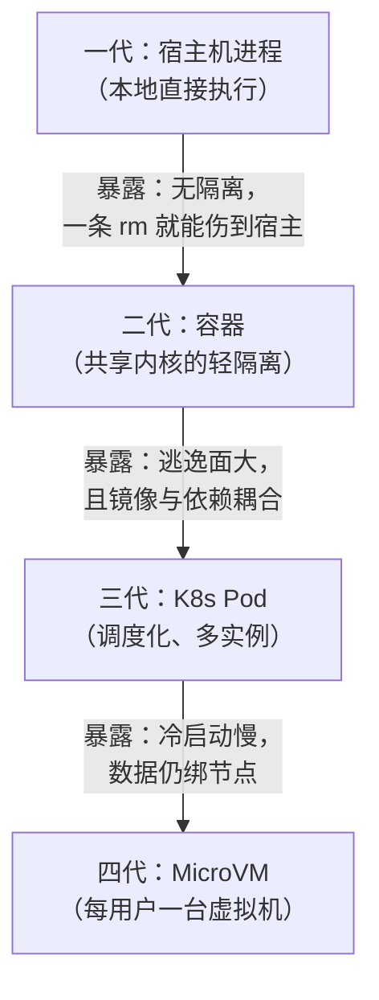
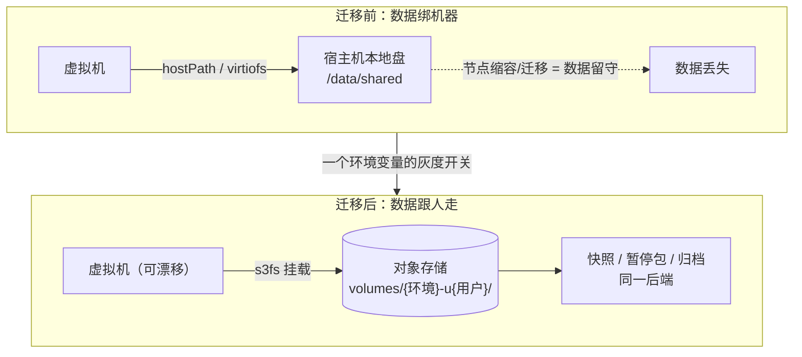
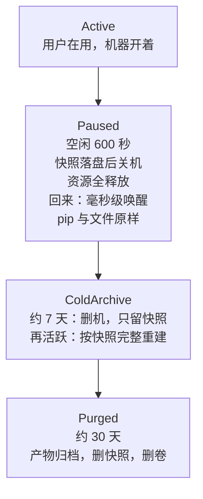
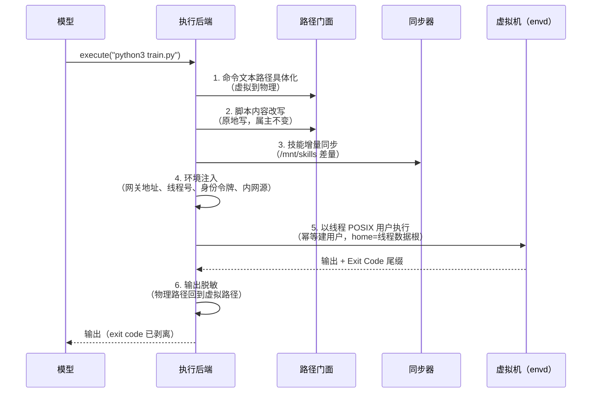

# Agent 的手：一台用户一台虚拟机，和它带来的所有麻烦

> Agent 平台改造实录 · 04（全八篇）
>
> 这个系列复盘我们在一个生产 Agent 平台上的几场关键改造。它们都发生在模型外围的那一层——业内现在叫它 **Agent Harness**：agent 循环、工具调用协议、上下文与能力供给、沙箱执行、状态恢复，把一个"会说话的模型"变成"能干活的系统"的全部夹具。这里的题目从来不是让模型变强，而是让这层夹具能上线、能运维、能长大。八篇从模型身边一圈圈长出去，直到整个平台：
>
> - **01**：能力供给——技能体系的三次搬家与四代检索。
> - **02**：状态与账本——编排/执行分进程、历史/运行态分存储的两场分离。
> - **03**：行动协议——tool_call 的两类幽灵故障。
> - **04（本文）**：执行环境——沙箱的粒度、归属与休眠。
> - **05**：监督交互——把"向用户提问"做成一等协议。
> - **06**：上下文纵深——给 Agent 装记忆的三次返工。
> - **07**：运行时自身——性能与判活，平台免疫系统的故障预算。
> - **08**：收官——还没解决的问题，与生产型 Harness 检查清单。
>
> 写法上尽量回到第一性原理：不罗列"我们做了什么"，而是推演"约束是什么、为什么只有这一条路"。所有案例真实发生，系统与数值已做脱敏。

先讲一个事故，主角是 Linux 世界最不起眼的命令之一：`sed -i`。

我们的沙箱存储做过一次大迁移（细节在第三节）。迁移后不久，用户开始零星报障：模型明明用 `write_file` 写出了脚本，执行时却 `Permission denied`——脚本读不回来了。排查到的原因离奇又合理：执行链路里有个环节，要在每个 `python3 x.py` 前用 `sed -i` 把脚本内容里的虚拟路径改写成物理路径。`sed -i` 的实现是"临时文件加改名"，而**改名操作在新的存储后端上，会把目标文件物化成 `root:root 0640`**——属主变了，权限位变了，线程用户读不回来，且 `chmod`/`chown` 都报 EPERM，无法自愈。一个文本替换命令，制造了一批只能删除重写的文件。

这个事故值得作为本篇的起点，因为它暴露了沙箱的本质：**沙箱是模型与物理世界之间的一整套契约——路径的契约、属主的契约、生命周期的契约、信任的契约。** 契约的每一层，都要和真实的操作系统语义、真实的存储后端行为谈判。`sed -i` 只是谈判破裂的最小样本。

这篇讲我们的沙箱体系怎么长成今天这样：四代形态、一场粒度决策、一场存储迁移、一套三级休眠，和一条命令执行链路上的全部机关。

---

## 一、模型出意图，沙箱出副作用

先立第一性。harness 里所有组件中，沙箱的地位可以用一句话说清：

> **模型出意图，沙箱出副作用。** 文件写入、进程执行、网络请求、包安装——凡是对世界产生持久改变的，都发生在沙箱里。

这决定了沙箱的设计约束和前面几篇讲的组件不同：提示词错了重发一次就行，队列消息错了重写一遍就行，但**副作用的错误要靠隔离来兜，不能靠重试来兜**。隔离边界画在哪，事故的爆炸半径就停在哪。所以沙箱的第一个问题永远是：这个边界，用什么材料做？

我们用过四种材料，每代都在修上一代的命门：



*图 1：沙箱的四代形态。判据始终是同一个——隔离强度、启动速度、数据归属，三者凑齐的那一代才留了下来。*

第一代是"没有沙箱"：命令直接在宿主机进程里跑，demo 阶段够用，但它把模型的每一次失误都直接兑换成宿主机的事故。第二代上容器，轻快，但共享内核意味着隔离是"君子协定"——逃逸面太大，而且镜像里塞进科研依赖后，改一个包就要重做整个环境。第三代上 K8s，调度和多实例解决了，但 Pod 冷启动以十秒计，对"每轮对话都要用"的执行环境太重，数据也还绑在节点上。第四代落到 MicroVM：每用户一台 1 核 2G 的微型虚拟机，独立的 guest 内核，秒级创建、毫秒级唤醒——隔离强度和启动速度第一次同时达标，剩下的问题（数据归属）交给第三节的存储迁移解决。

值得点破的是：这个演进和第一篇的检索四代是同构的——**每一代暴露真实约束，下一代兑现教训**。区别在于沙箱的"教训"更疼：检索退化是质量事故，沙箱退化是安全事故。

---

## 二、粒度之战：一台用户一台，不是一台会话一台

形态定了 MicroVM，下一个问题是粒度：**一台沙箱给谁用？** 候选有三个：每会话一台、每用户一台、全局共享池。我们选了每用户一台——一个用户的所有对话共享同一台虚拟机，对话之间靠目录和操作系统用户隔离：

```
用户 u1 ──── 虚拟机 S1
              ├ 对话 t1：/mnt/threads/t1/user-data/{workspace,uploads,outputs}
              ├ 对话 t2：/mnt/threads/t2/user-data/...
              └（对话内再按线程 POSIX 用户隔离，见第六节）
用户 u2 ──── 虚拟机 S2
```

为什么不是每会话一台？因为会话是临时的，而**用户的环境是有积累的**：这一轮 `pip install` 装的分析库、上一轮下载的数据、改过的配置——用户期望"我的 Agent 记得我的环境"。每会话一台，每次对话都从白板开始，pip 装到一半的依赖随会话蒸发。每用户一台，环境跟着人走，代价是必须回答"两个对话同时跑怎么办"。

为什么不是全局池？共享池把所有租户的副作用放进同一个执行域——隔离边界的粒度直接退化回第一代。

共享一台的真实并发语义，我们逐项验证过，值得原样抄在这里：

| 维度 | 行为 |
| --- | --- |
| 进程执行 | ✅ 数据面按请求 spawn 独立 bash 进程，两个对话同时发命令互不干扰 |
| 文件系统 | ✅ 线程目录分域 + 每线程 POSIX 用户 |
| CPU / 内存 | ⚠️ 共享 1 核 2G 配额——并发重计算互相拖慢，guest 内核 OOM 会波及双方 |
| 内核 / 网络 | ⚠️ 共享 guest 内核与网络栈（fork bomb、端口冲突互相影响） |
| 暂停/恢复竞态 | ⚠️ 唤醒窗口内数据面请求会 502，靠重试兜底 |

注意这张表里 ✅ 和 ⚠️ 的分界线：**进程和文件这两个"模型日常触碰"的维度做到了真隔离；内核和配额这两个"出事才暴露"的维度是共享的。** 这是成本与隔离的主动取舍——真硬隔离需求出现之前，不为它预付每会话一台的成本。粒度决策的本质不是选一个答案，而是**把"我们接受什么样的共享"写成一张明账**。

---

## 三、归属之战：数据跟人走，不跟机器走

第四代形态落定后的头几个月，最大的痛处是存储：用户数据放在宿主机目录（hostPath），通过文件系统共享挂进虚拟机。这个设计有一个从第一天就知道、但忍到无法忍的缺陷——**绑死单节点**。沙箱迁移、节点缩容、集群升级，任何一个动作都会让数据"留在原地、实例去了别处"。我们打过一堆补丁（配置推送、目录同步），全是给"数据在机器上"这个根因止血。

迁移的方案现在说起来一句话：**用户级卷。** 每个用户一个对象存储上的卷，挂载到虚拟机的 `/mnt`，线程目录结构原样保留。数据从"节点的本地盘"变成"对象存储里的一个桶前缀"——节点只是临时的宿主，实例可以漂移、可以重建，数据跟着用户 ID 走。



*图 2：存储迁移。挂载方式从 hostPath 换成对象存储卷，切换带灰度回滚开关——关掉开关就回到老路径，新老数据互不干扰。*

两个设计细节值得单独说。

**其一，双存储边界。** 迁移后系统里有两套对象存储：沙箱系统自己的（放卷、暂停包、快照）和平台业务侧的（放用户上传、产物归档、签名下载）。两套**凭据互不穿透**，唯一的桥是沙箱的文件 API。为什么刻意留这道墙？因为沙箱后端对卷有销毁权——`Volume.destroy` 是治理动作，它必须**在物理上不可能碰到**用户上传和归档数据。两个信任域之间的连接，要么走显式 API，要么迟早出事故。

**其二，命名与对账。** 卷名由环境前缀加清洗过的用户 ID 构成；每台虚拟机在控制面登记 metadata（用户 ID、环境、管理者）——这不是装饰字段，是**孤儿对账的锚点**：Redis 里的"用户→沙箱"绑定一旦丢失（比如 Redis 重启），拿 metadata 去控制面反查，就能把无主沙箱认领回来，而不是重复建新沙箱把旧实例变成孤儿。绑定会撒谎，控制面的元数据是第二路证据——第七篇"判活不能靠单点信号"的原则，在存储层又应验了一次。

而 `sed -i` 的故事，正是这次迁移的直接代价：换掉的不只是挂载方式，还有整个文件系统的语义面。s3fs 后端上，"改名"不再是原子的元数据操作，而是"写新文件、删旧文件"——所以属主和权限位会被物化成默认值。我们的修复是双管齐下：文本改写从"临时文件加改名"改成**原地截断写**（只改内容，属主与权限原样保留）；上传链路写完文件后把"文件加父目录"的属主**交接**给线程用户——写入身份保持 root 不变（既有文件属主可能是 root，换身份写反而写不进去），交接只收敛属主、不改变可写性，且严格限定在本线程目录之内。

> **换存储后端，换的不是容量，是文件系统语义。** 每一个依赖"改名原子性""权限位继承""属主稳定性"的代码，都要重新过一遍堂。

---

## 四、休眠：三级休眠的物理语义

存储解决"数据放哪"，生命周期解决"机器什么时候关"。每用户一台虚拟机，最大的成本焦虑随之而来：一万个用户就是一万台机器？答案是让"关机"成为常态——但关机也分三种深度，各有各的物理语义：



*图 3：三级休眠状态机。关键认知：pause 不是"暂停"，是"快照落盘后关机"——物理资源全部释放，只是保留了一个毫秒级可恢复的回来路径。*

这里最容易误解的是 pause。很多人把 pause 理解成"挂起、占着内存"——那是最贵的状态。现代 MicroVM 的 pause 语义是：**把整个运行时状态（文件系统加内存）快照落盘，然后真的关机**。宿主侧物理资源完全释放，只剩磁盘上的暂停包。用户回来时连接请求自动唤醒，几十毫秒内恢复原状——包括 pip 装到一半的依赖、内存里的变量。所以"每用户一台虚拟机"的真实成本公式是：**活跃用户付机器钱，沉默用户付存储钱，长期沉默用户只付一个快照的钱。**

三个深度之间的落差都是数量级的：运行 ≫ 暂停包 ≫ 快照。而快照冷档（约 7 天后删虚拟机、留快照）还有一个漂亮的性质：**快照可以直接当模板重建虚拟机**——用户"装了大量工具"的环境，恢复时原样回来，甚至可以固化成新模板。

配套的是一个后台回收器（reaper），按保留期执行降档：活跃保留期过 → 快照冷档；归档期过 → 产物搬到业务存储、删快照删卷；绑定丢失的孤儿 → 按 metadata 对账回收。这里有一条用别人事故换来的铁律：**回收保留期必须显式设置。** 我们参考的同行案例里，有一家默认"永不回收"——沙箱无限堆积，最后以一次七百多个沙箱的清理事故收场。GC 参数不是配置细节，是容量承诺。

还有最后一层：**沙箱的"释放"永远不做任何破坏。** 一轮对话结束，执行层对沙箱只做引用释放——不暂停、不销毁。因为这台机器是用户的所有对话共享的，你不知道别的对话是否还在用；暂停的权力只属于沙箱自己的空闲计时器。"释放即 no-op"这个看似偷懒的设计，根因就在粒度决策里：**共享的东西，任何单一持有者都无权处决。**

---

## 五、深潜：一条命令的旅程

前四节是体系，现在把镜头拉到最近处：模型发出 `execute("python3 train.py")` 之后、输出返回之前，这条命令经历了什么。这条链路是整个沙箱契约的最完整样本：



*图 4：一条 execute 的六道工序。模型的世界里只有虚拟路径；物理世界的一切，在这六道工序里进出各一次。*

**第一道，路径具体化。** 模型看到和说出的永远是虚拟路径（`/mnt/user-data/...`），但虚拟机里真实的位置是线程物理目录。命令自由文本里的虚拟路径段在这一步被替换成物理路径——**虚拟路径是协议，不是命名习惯**：模型不需要也不应该知道"我这条对话的文件放在机器的哪个角落"，更不应该知道换个环境（比如桌面端）之后路径会怎么变。

**第二道，脚本内容改写。** 命令引用的脚本文件，内容里可能也写着虚拟路径——执行前把文件内容里的路径一并改写。这就是 `sed -i` 出事的环节：现在是原地截断写，属主与权限位原样保留。一个细节：改写发生在虚拟机侧（经文件接口），后端只生成"要改什么"的意图——**越靠近执行侧，越不该有跨系统的原子性假设**。

**第三道，技能增量同步。** 第一篇讲过技能物化进共享缓存，这一步把缓存与虚拟机内挂载点做差量对齐——本轮要用而虚拟机里没有（或版本旧了）的技能文件，此刻补齐。技能体系（第一篇）和沙箱体系（本篇）在这里握手。

**第四道，环境注入。** 命令前面拼一段 `export`：网关地址（脚本要回调平台 API）、线程号、当条命令现签的身份令牌（约 2 小时时效的平台 JWT）、内网包源。每条命令现签现注入——**凭证的生命周期锚定在单条命令上**，而不是会话或进程上：命令结束令牌即弃，脚本里不存在任何长期秘密。

**第五道，以线程用户执行。** 命令不是以 root 跑的。虚拟机里为每条对话幂等地创建一个专属 POSIX 用户（`useradd`，home 目录就是这条对话的数据根），命令以这个用户身份执行。这样即使两条对话共享一台虚拟机，文件系统的属主边界天然成立——A 对话的脚本进程，在操作系统层面就够不着 B 对话的目录。

**第六道，输出脱敏。** 命令输出里可能出现物理路径（工具打印的绝对路径、报错栈），返回给模型前统一反向映射回虚拟路径，末尾的 Exit Code 标记被剥离后放进结构化字段。**进出各洗一次**：进去时虚拟变物理，出来时物理变虚拟——模型的世界观保持完整，它永远只认识那套虚拟路径。

六道工序串起来的设计观察，还是那两条老原则的变体：**翻译集中、语义双向**（路径只在这条链路上转换，进出各一次，任何旁路都会漏）；**身份最小**（每条命令一个短期身份、一个专属系统用户，权限的边界画在操作系统层，而不是靠提示词央求模型"别乱看"）。

---

## 六、信任的边界：三重身份，和另一台机器

第五节的后端是平台自己的虚拟机——信任模型相对简单：机器是平台的，身份是平台签的。但沙箱体系还有第二个成员，它把整个信任模型倒了个个儿：**桌面客户端沙箱。**

一部分用户的使用形态是"沙箱在我自己电脑上"：工具调用经 WebSocket 转发到用户桌面端的一个客户端，由客户端在本机执行后回传结果。对这类会话，文件在用户磁盘上，命令以用户的本地身份跑——平台的虚拟机根本不出场。

这个形态的信任关系和云沙箱完全不同：云沙箱里，平台信任自己签发的身份、隔离自己控制的内核；桌面沙箱里，**执行发生在用户自己的机器上，用户理应拥有最终否决权**。所以我们给桌面会话配了一套路径分类权限模型，取代早期"一刀切禁止访问工作区之外"的粗口径。所有工具涉及的路径先分类，再按三档处置：

- **放行**：工作区内的常规读写；
- **审批**：受保护名称的写入/删除/移动、工作区之外的路径、用户凭据目录的读取——工具调用挂起，弹窗等用户批准；被拒后模型带着"被拒"标记原样重试的契约也写明在案；
- **禁止**：明确不可触碰的区域。

复合操作（一条命令涉及多个路径）**取最严格的一档**。而"全访问"模式的会话则声明不做路径分类、无审批弹窗——这是用户自己的选择权，不是平台的恩赐。顺带一个产品细节：桌面会话的提示词里甚至不出现那套虚拟路径——它的"虚拟路径"就是用户自己的真实目录，模型可见文本里不做任何伪装。**契约要诚实到什么程度，取决于信任方向**：平台侧虚拟机用虚拟路径隐藏物理细节，用户自己的机器上没必要演戏。

现在把三重身份摆在一起，沙箱体系的信任全景就完整了：

| 身份 | 谁签发 | 生命周期 | 守什么 |
| --- | --- | --- | --- |
| 平台用户身份（JWT） | 执行侧每条命令现签 | 单条命令（约 2 小时时效） | 脚本回调平台 API 的权限 |
| 线程 POSIX 用户 | 虚拟机内幂等创建 | 对话生命周期 | 同机对话间的文件属主边界 |
| 用户本人（桌面） | 操作系统登录 | 会话 | 自己机器上的一切 + 审批权 |

三层身份，三种粒度，从"命令"到"对话"到"人"。它们不是冗余——每一层对应一类真实的越权向量：脚本冒用平台身份、进程跨对话读文件、模型在用户机器上乱来。**权限的层数，由攻击面的层数决定。**

---

## 七、代价与未解决的问题

诚实清单，照例。

**s3fs 的语义面仍在流弹。** `sed -i` 是第一个被击中的，不会是最后一个。对象存储挂载的文件系统在权限语义、链接、原子性上都弱于本地盘，每一项都可能在未来某个深夜变成工单。已知的缓解是"重计算和频繁 IO 留在可写层，卷只放数据"，但语义边界的完整清单，我们没有、也短期拿不到。

**共享内核是隔离的天花板。** 每用户一台虚拟机隔离了用户之间，但同一用户的多条对话共享 guest 内核与网络栈——fork bomb、端口占用、内核 OOM 都会互相波及。目录和属主挡住了"误读"，挡不住"误伤"。真硬隔离出现需求的那天，粒度决策要重做。

**线程目录的权限位还有缺口。** 建目录的幂等命令目前只做属主收敛（chown），没有做权限位收紧（chmod）——同机其他线程的系统用户理论上可读。本地调试后端已经收紧到目录 0700/文件 0600，云沙箱侧的收紧在新存储后端上的行为还需验证后落地。又一个"语义待验证"的例子。

**唤醒风暴是已知的悬崖。** 批量沉默用户同时回来，恢复请求会撞上容量保证与密度的矛盾（调度器 409）。我们留了重试，也留了调度配额的旋钮，但"多大的用户基数配多少的唤醒余量"这道容量题，只有流量能批改。

**孤儿与快照的容量账。** metadata 对账机制在，reaper 在，但快照体积（每用户暂停包几百 MB 起步）乘以用户规模的容量规划，是一个我们刚开始做、还没有把握的估算题。

---

## 八、收束：契约的清单

回头看，沙箱这一篇其实是四份契约的签订史：

- **隔离契约**（形态与粒度）：模型出意图、沙箱出副作用——副作用发生在哪，隔离边界就必须画到哪；粒度选完，把"接受什么样的共享"写成明账。
- **归属契约**（存储）：数据跟人走，不跟机器走；换后端换的是文件系统语义，不是容量。
- **休眠契约**（生命周期）：pause 是关机不是挂起；成本公式是活跃付机器钱、沉默付存储钱；回收保留期必须显式设置。
- **信任契约**（身份）：权限的层数由攻击面的层数决定；在用户自己的机器上，否决权归用户。

五条可迁移的原则：

1. **隔离边界对齐副作用边界。** 模型能改到的一切，都在边界内；边界外的一切，模型连路径都不该知道。
2. **虚拟路径是协议。** 翻译集中在一处、进出各一次；模型的世界观完整性，比路径的"真实感"重要。
3. **数据归属决定存储形态。** 数据属于谁（用户/会话/平台），就该跟着谁的标识走；跟着机器走的数据，迟早被机器的变动丢下。
4. **凭证生命周期锚定在最小使用单元。** 单条命令一签，比会话级令牌少一整类泄漏面。
5. **共享的代价要写成明账。** 任何"共享一台"的设计，都必须附一张并发语义矩阵——✅ 是承诺，⚠️ 是告知，两者都不能含糊。

下一篇离开机器，回到对话本身：Agent 问用户"用哪个参数"、然后停下来等的那段时间里，系统里发生了什么。等待如何被做成一种持久化的协议状态，而不是一个转圈的 UI——那是人机交互工程化的完整故事。

---

*为保护项目与客户信息，文中系统名、工具名、业务场景和具体数值均做了抽象或区间化处理；技术结论不受影响。*
