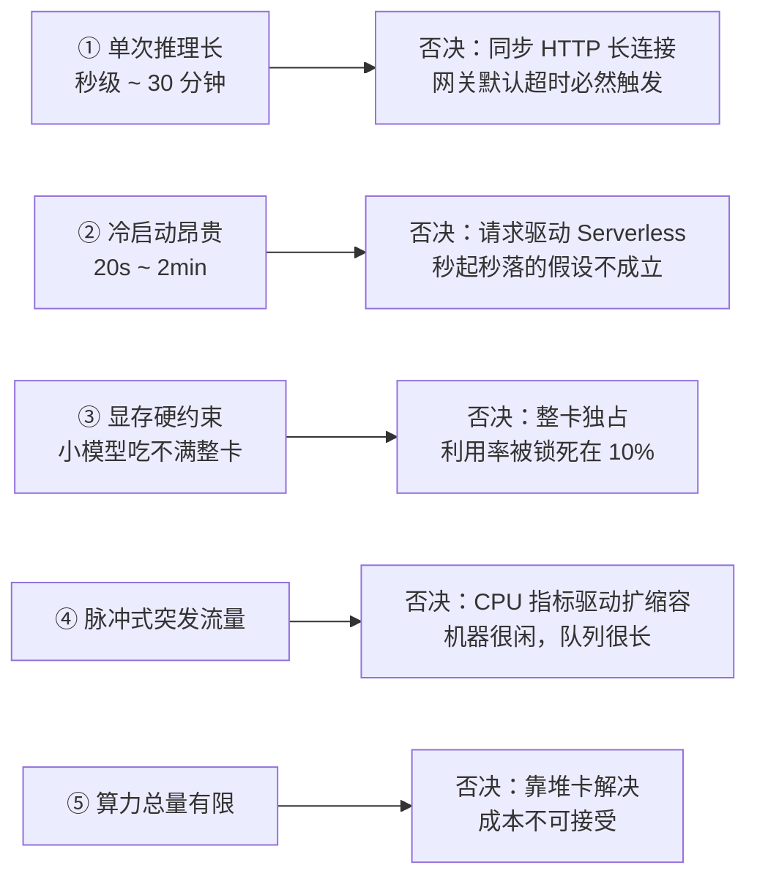
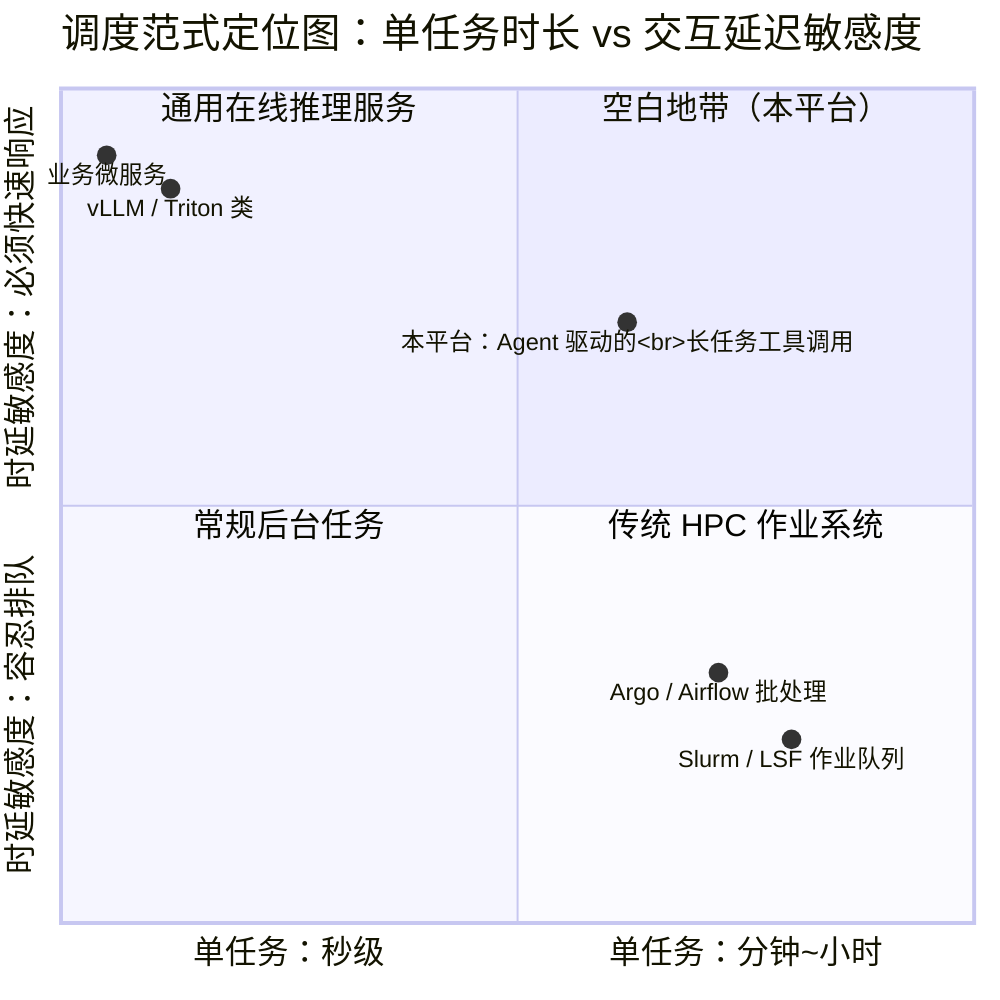
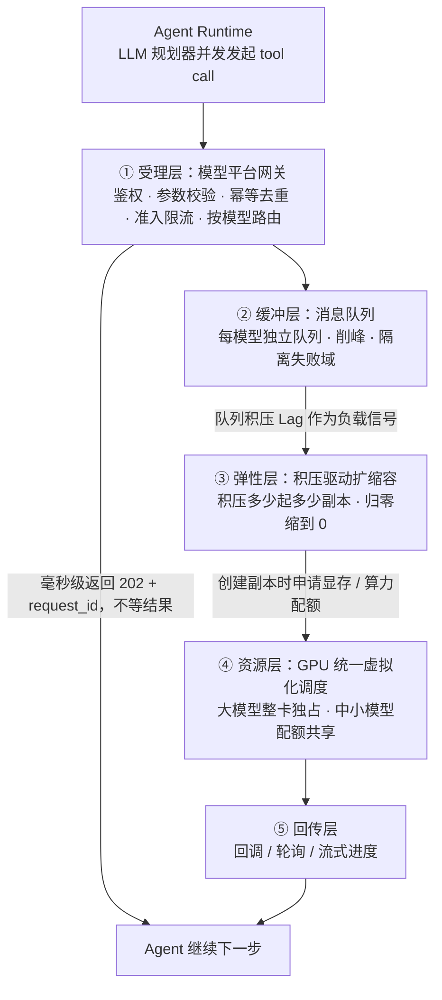
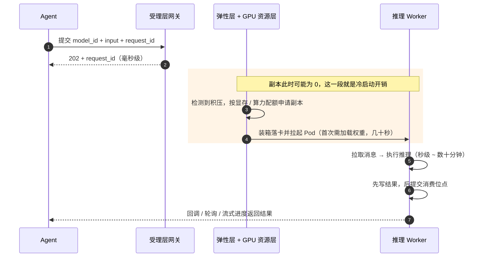

# 有限 GPU 算力下，如何为生命科学 Agent 搭一套推理平台（一）：负载画像与架构概览

> **系列导读**：本系列尝试回答一个具体问题——当 GPU 卡数是固定的，而上层是一个会自主规划、批量调用工具的生命科学 Agent 时，中间的推理层该怎么搭。
>
> - **第一篇（本文）**：这类负载到底特殊在哪，为什么主流推理服务架构和传统 HPC 都答不好这道题，以及我们的整体架构长什么样。
> - **第二篇**：具体的技术选型与 trade-off——为什么不是 vLLM、不是 Triton、不是 Slurm，而是 Kafka + KEDA + HAMi 这套组合；三大核心矛盾怎么取舍。
> - **第三篇**：平台与 Agent 怎么对话，以及怎么度量"这套系统到底有没有变好"。
>
> **发布说明**：第一篇已发布至 `_agent/life-science-inference-platform-part1.md`（站点路径 `/agent/life-science-inference-platform-part1/`），图表使用 `assets/images/agent/life-science-inference/` 下 PNG。本 draft 目录供第 2、3 篇撰写，构建时已 `exclude: draft`。

---

## 一、Agent 的大脑是 LLM，但让它可以动手的是垂类模型

先建立一个具体的画面。假设我们交给 Agent 一个任务：**"针对靶点 KRAS G12D，设计几条候选结合蛋白，并评估结合能力。"**

一次完整执行可能是这样的：

1. Agent 规划出一个多步方案：先设计骨架，再预测复合物结构，再评估亲和力；
2. 第一步调用 `RFDiffusion` 生成候选骨架（一次调用生成 N 个设计，单次可能跑十几分钟）；
3. 拿到骨架后，对 N 个候选**并发**调用 `Boltz-2` 或 `Protenix` 做复合物结构预测（每次几分钟）；
4. 再用亲和力模型打分，挑出 Top 几条；
5. 不满意的话回到第 2 步，换个约束再来一轮。

这条链路里有三个对基础设施极其不友好的事实：

- **调用数量不可预测**：规划器一次决定发 3 个还是 30 个 tool call，平台事前不知道；
- **并发而非串行**：Agent 会同时把 N 个候选丢下去，流量是脉冲式的，没有"平稳均值"这回事；
- **任务时长跨越三个数量级**：从秒级的 Embedding 打分到十几分钟级的扩散采样，混在同一次会话里。

换句话说，**LLM 是规划者，垂类科学模型才是执行者**。平台的绝大部分 GPU 时间、绝大部分工程复杂度，都在后者这一侧。如果我们还用一个面向通用大模型服务的架构去承载这些执行者，削足适履几乎是必然的。

典型的四个模型及其负载画像：

| 模型 | 用途 | 计算特征（量级，需实测校准） |
|---|---|---|
| OpenFold3 | 蛋白/复合物结构预测 | 显存占用高（数十 GB），单次推理分钟级 |
| Boltz-2 | 生物分子结构 + 亲和力预测 | 显存中高，秒级~分钟级 |
| Protenix | 结构预测（AlphaFold3 复现） | 显存中高，分钟级 |
| RFDiffusion | 蛋白骨架从头设计 | **扩散迭代，单次可达 10~30 分钟**，长任务典型代表 |

## 二、这条否决链：五个特征如何逐一杀掉"标准答案"

我们把这类负载抽象成五个结构性特征。有意思的地方在于：**每一个特征，都会精确否决掉一类成熟的通用方案**。

### 特征 1：单次推理耗时长（秒级 ~ 数十分钟）

这直接否决了**同步 HTTP + 长连接**。Agent 框架侧普遍的 tool call 超时在 30~60 秒量级，一个跑 15 分钟的 RFDiffusion 挂在 HTTP 请求里，超时是物理层面的必然，不是调参能解决的。

更麻烦的是中间件：网关、负载均衡、服务网格通常都有默认 60s 级别的超时；长连接在链路上每一跳都是风险点。所以**异步化不是优化选项，而是前提**。

### 特征 2：冷启动昂贵（20 秒 ~ 2 分钟）

模型权重加载 + CUDA 上下文初始化往往要几十秒到两分钟。这否决了**纯粹的请求驱动 Serverless GPU**（Knative 这类）：它的经济学建立在"容器秒起秒落"的假设上，对分钟级冷启动的模型，这个假设不成立。

### 特征 3：显存是硬约束，但大量模型用不满整卡

OpenFold3 这类大模型一张 A100-80G 起步；但大量垂类中小模型显存需求只有 5~25GB。**如果一个 8GB 显存需求的小模型独占一张 80GB 的卡，利用率天花板就是 10%**。这是本项目最大的一块浪费来源，也决定了我们必须做 GPU 切分共享，而不是简单堆卡。

### 特征 4：流量突发且极度不均

Agent 的一次规划可以瞬间打满队列，然后长时间静默。这意味着：基于"平均利用率"做容量规划会翻车；基于 CPU 使用率做扩缩容根本抓不到信号（GPU 推理的 CPU 占用可能很低，而 GPU 已经在排队了）。

### 特征 5：算力总量有限

如果资源无限，很多麻烦会消失。**正因为卡数固定，架构的正当性才完全建立在"把一张卡的时间卖出去、卖得贵、还不违约"这件事上。**

一句话概括：**长任务 + 冷启动贵 + 脉冲流量 + 资源稀缺，这四者互相放大**，任何一个标准方案都只解决了其中一角。

## 三、为什么通用推理栈和传统 HPC 都答不好这道题

行业里其实有两个成熟范式，但都不完全适用。把它们的假设拆开看，能更清楚地定位我们在做什么。

从"任务时长"和"对交互延迟的敏感度"两个维度画出来，会发现我们的负载落在了**两者之间的空白地带**：

| 维度 | 通用在线推理服务 （vLLM / Triton / KServe 类） | 传统 HPC 作业调度 （Slurm / LSF / PBS 类） | **我们的场景** |
|---|---|---|---|
| **任务时长假设** | 毫秒~秒级 | 分钟~小时级，甚至天级 | 秒级 ~ 30 分钟，**跨三个数量级** |
| **调用者** | 人或上层服务，QPS 相对稳定 | 人提交作业后离线等待 | **Agent**，自主决策、突发并发 |
| **核心优化目标** | 低延迟、高吞吐（continuous batching） | 公平性、回填（backfill）、集群利用率 | 交互响应可接受 + 单位算力产出最大 |
| **排队语义** | 尽量不排队，排队即降级 | 排队是常态，用户接受等待 | **部分排队可接受，但必须能预测** |
| **结果返回** | 同步响应 | 作业日志 + 文件系统 | 需要结构化回传给调用方（Agent） |

**通用在线推理栈的假设错在哪**：它假设请求是短的、无状态的、同质化的，所以能用一个统一的连续批处理引擎把吞吐打到最大。但我们的负载里混着 20 分钟的扩散采样任务，单个请求就把 batch slot 占满，你无法对它做「批处理优化」——它天生就是独占资源的。

**传统 HPC 调度器的假设错在哪**：它假设使用者是人，提交作业后可以离线等待几小时，所以调度器可以慢慢排队、慢慢回填。但 Agent 的 tool call 是一个**交互式循环**：Agent 拿到结果后立即决定下一步，等两小时意味着整个 Agent 会话失去意义。Slurm 生态也缺乏"结果作为结构化消息回传给调用方"的一等公民语义。

**所以我们要做的是第三类东西**：一套既要有 HPC 的队列与资源治理能力（因为任务长、资源紧），又要有在线服务的低延迟受理与结构化回传能力（因为调用方是 Agent）的系统。它的正确定位是：**用在线服务的受理方式，跑 HPC 级别的任务，并且所有中间状态对调用方可见**。

这个定位一旦清晰，架构形态基本就被决定了。

## 四、整体架构：一条主链路，五层职责

这套架构由**四个基本决定**锚定，每一个都是被上面的负载特征逼出来的：

### 决定一：受理与执行彻底解耦（解决特征 1）

网关只做"收单 + 入队"，毫秒级返回 `request_id`；真正的结果通过回调、轮询或流式进度送回。长任务的超时问题在入口处就被消解，而不是靠无限调大超时硬扛。

这里有个容易被低估的连带收益：**受理层可以做得非常轻量，因此可以在它上面做大量"便宜的保护"**——参数合法性校验、权限、配额、预算检查。在一个每条请求可能消耗十几分钟 GPU 时间的系统里，能在入口用几毫秒拦下一个错误的请求，价值极高。**让错误在跑起来之前就暴露，而不是烧了 20 分钟 GPU 之后才失败。**

### 决定二：按模型隔离队列（解决特征 4 + 5）

每个模型一条独立队列、独立的消费者组、独立的弹性策略。这带来三层收益：

- **故障隔离**：某个模型流量暴涨或持续 OOM，爆炸半径被限制在自己的队列里；
- **策略可差异化**：短任务、长任务、超大模型可以各自配置完全不同的扩缩容与 GPU 策略——这是本架构能用一套框架覆盖三个数量级任务时长的关键；
- **接入成本低**：新增一个模型 = 新增一条队列 + 一个镜像 + 一份弹性策略，网关核心逻辑零改动。

### 决定三：用"积压量"而非"资源使用率"驱动扩缩容（解决特征 4）

传统的 CPU/内存使用率指标在这里失灵：GPU 推理时 CPU 可能很闲，而请求已经堆成队列。**队列积压（Lag）是最贴近真实负载的信号**——它直接表示"还有多少活没干"，而不是"机器忙不忙"。

而且 Lag 还有一个别的指标给不了的好处：**它可以缩到零。**当 Lag 归零时，意味着确实没活，此时把副本降到 0 是安全的。这在 GPU 这种昂贵资源上是决定性的省钱手段——低峰期"有活满负荷、没活不占卡"。

### 决定四：弹性层与资源层正交（解决特征 3 + 5）

这是我们认为最需要被强调的一个设计原则：

> **"要不要扩"和"扩到哪张卡上的多少配额"，是两个正交的决策。**

前者由弹性层回答（副本数），后者由 GPU 资源层回答（卡内分配）。很多团队试图用一个调度器同时做这两件事，结果两头都做不好：扩缩容信号被资源碎片污染，资源分配又被副本波动打乱。

拆开之后，两层各自演化：弹性层专注"按积压算出该有几个 worker"，资源层专注"如何把这批 worker 安全地装箱到有限的卡上"。**第二篇会详细展开这两层各自的选型与边界。**

## 五、一条请求的生命周期

把四个决定串起来，看一次完整调用：

注意第 2 步和第 3 步之间的高亮区：**这就是冷启动延迟的来源，也是整个架构最昂贵的一段时间。**第二篇会专门讲它。

同时注意第 6 步的顺序——**先写结果，再提交消费位点**。这个顺序决定了系统可能是"重复算了几次"（可幂等消除），而不是"丢了任务"（不可恢复）。这是第三篇里可靠性语义的核心。

## 六、本篇小结

- 生命科学 Agent 的推理负载，本质上是**长任务、冷启动贵、显存约束硬、脉冲式流量、资源总量稀缺**五个特征叠加；
- 这五个特征逐一否决了同步 HTTP、纯 Serverless、整卡独占、CPU 指标驱动扩缩容等常见做法；
- 它既不是通用在线推理（任务太长），也不是传统 HPC（太不抗等待），定位是"**用在线服务的受理方式，跑 HPC 级别的任务**"；
- 架构由四个决定锚定：**受理与执行解耦、按模型隔离队列、积压驱动弹性、弹性层与资源层正交**。

下一篇我们不再讲抽象，直接落到**选型**：为什么这套链路最终落在消息队列 + Lag 驱动弹性 + GPU 虚拟化的组合上，而不是 vLLM / Triton / Slurm 这套现答案里的任何一个；以及三个互相打架的核心矛盾——**缩到零 vs 冷启动、长任务 vs 弹性缩容、整卡独占 vs 切分共享**——分别是怎么折中的。
