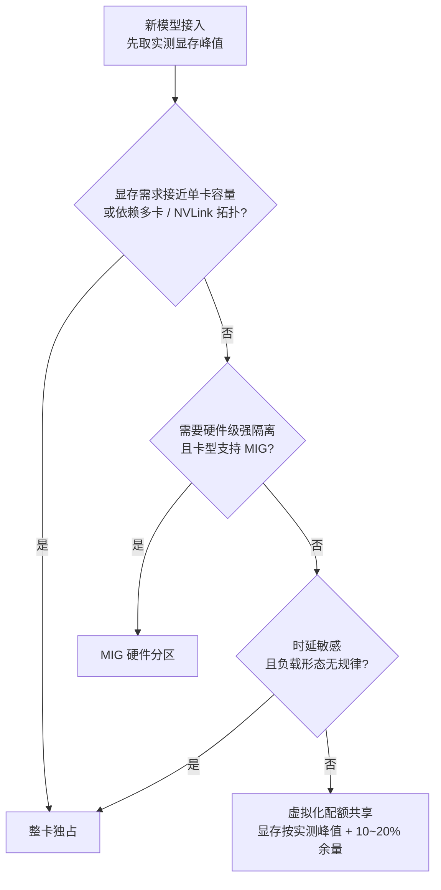
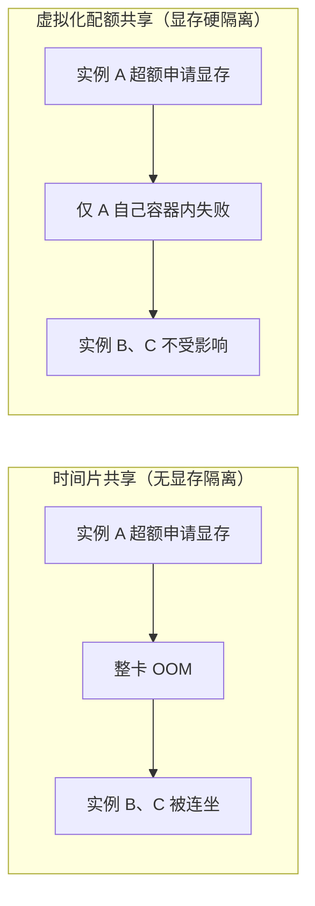
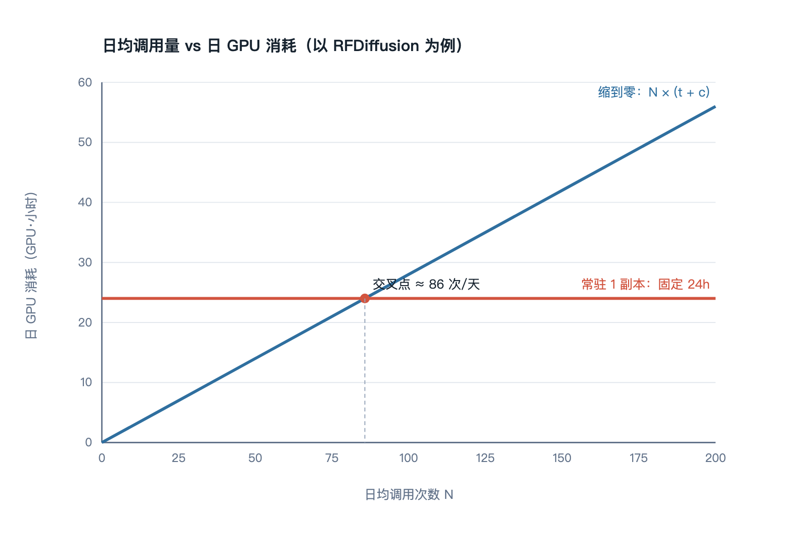
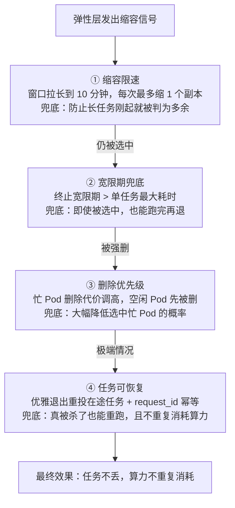

# 有限 GPU 算力下，如何为生命科学 Agent 搭一套推理平台（二）：选型与 Trade-off

> **系列导读**：这是系列的第二篇。
>
> - **第一篇**：回顾：负载的五个结构性特征如何否决掉标准答案，以及架构的四个基本决定（受理与执行解耦 / 按模型隔离队列 / 积压驱动弹性 / 弹性层与资源层正交）。
> - **第二篇（本文）**：这些决定落地到具体技术栈时怎么选，为什么最终是"消息队列 + Lag 驱动弹性 + GPU 虚拟化"这套组合；以及三个互相打架的核心矛盾如何折中。
> - **第三篇**：平台与 Agent 怎么对话，以及怎么度量"系统到底有没有变好"。
>
> **关于图表**：文中图表以 Mermaid 源码内嵌，GitHub / 掘金 / 知乎等平台可直接渲染；若发布到不支持 Mermaid 的渠道（如公众号），可用 `figures/` 目录下的同名 PNG / SVG。

---

上一篇我们留了个尾巴：架构被四个决定锚定之后，还剩两个问题没答——**用什么实现排队？用什么实现弹性？GPU 到底怎么分？**

这三个问题各自都有若干"看起来很香"的成熟方案，而我们的判断是：**大部分方案不是不好，是它们优化的目标和我们不一样**。这一篇把选型过程和取舍逻辑摊开讲。

## 一、先立四条评判标准

选型之前先定标尺，否则会陷入"大家都有道理"。我们用的是这四条：

| 标准 | 具体追问 |
|---|---|
| **① 扩缩容信号是否贴近真实负载** | CPU / 内存使用率在 GPU 推理场景下失灵——机器很闲但队列很长的时候，它能感知吗？ |
| **② 能否缩到零** | 这是 GPU 场景最硬的省钱手段。K8s 原生 HPA 不支持缩到 0 副本，很多方案在这里就出局了 |
| **③ 能否做多租户与多模型的隔离** | 能不能按模型、按租户设配额？一个租户的批量任务能不能拖垮另一个租户的交互式请求？ |
| **④ 生态成熟度与运维成本** | 团队愿不愿意长期维护？出问题时有没有社区经验可查？ |

特别说明一下 ②：**K8s 原生 HPA 是不能缩到零副本的**（最小副本数为 1）。对 GPU 这种昂贵资源，这个限制几乎是致命的——一个每天被调用 20 次的工具，为了不违反这个限制要常驻一张卡，利用率可能不到 10%。

## 二、链路选型：为什么不是 vLLM，也不是 Slurm

把候选方案按上面四条标准过一遍：

| 方案 | 核心失败点 | 结论 |
|---|---|---|
| **同步 HTTP + 基于 CPU 的 HPA** | 违反 ①（CPU 完全反映不了 GPU 排队）、违反 ②（缩不到 0）、长任务必然超时 | 出局 |
| **Serverless GPU（Knative 类）** | 满足 ②，但冷启动对分钟级加载的蛋白模型不可接受；GPU 生态成熟度不足 | 暂不用，长期观察 |
| **纯批处理离线化（Airflow / Argo）** | 不满足交互式响应，Agent 会话会失去意义 | 作为**旁路**长期建设 |
| **自研队列 + KEDA** | 可行，但等于自己承担队列的可靠性、持久化与吞吐 | 备选 |
| **消息队列（Kafka）+ Lag 驱动弹性 + GPU 虚拟化** | 四条标准全部满足 | **主链路采用** |

这里有两个读者常问的问题，值得单独回答。

### 为什么不用 vLLM / Triton 这套？

因为它们**解决的不是我们这一层的问题**。

vLLM 的 PagedAttention、Triton 的动态批处理、continuous batching，优化的是"大量短请求如何在一张卡上摊薄开销"——它假设请求是可抢占、可合并、尺寸相近的。而我们的负载里，一个 RFDiffusion 请求会独占一张卡跑 15 分钟，它没有"批处理"的空间：你没法把两个 15 分钟的扩散采样塞进同一个 batch slot 里省时间。

但要诚实补充一句：**这不代表它们没用，只是位置不同**。它们属于"单卡内的执行效率层"，我们这套属于"跨卡的任务调度层"。两层是正交的：对于可批处理的模型（Embedding 类、部分结构预测），在 worker 内部引入动态批处理仍然是有效的优化手段；未来模型数量增多后，把部分模型迁移到 Triton 统一执行引擎也是合理的演进方向。**只是它替代不了上层那套排队与弹性机制。**

### 为什么不用 Slurm 那套？

Slurm / LSF 是极其成熟的资源管理器，backfill 算法、公平份额（fairshare）、优先级衰减都做得非常好。问题在于它们的**交互契约**：作业提交后你去查状态、去看日志、去文件系统取结果，整个语义是面向"人提交作业后离线等待"设计的。

Agent 需要的是：返回一个结构体、任务失败时返回结构化错误原因、能被告知"前面还有 8 个任務，预计等 4 分钟"。这些不是 Slurm 不能做，而是不在它的核心语义里，硬搬过来要在外面包一层厚厚的服务层——那就等于我们自建一个平台，只是底层换了批调度器。

**结论：用消息队列做缓冲与在线式受理，用积压驱动弹性取代传统的 CPU 指标弹性，用专用的 GPU 虚拟化层管卡内分配。**

## 三、GPU 资源层选型：一张卡究竟怎么分

这是本项目中收益最直接、也最容易踩坑的一层。候选方案四条：

| 方案 | 隔离机制 | 优点 | 致命缺陷 |
|---|---|---|---|
| **整卡独占** | 物理 | 零干扰、性能确定性最好 | 小模型浪费严重，8GB 的模型占 80GB 的卡 = 利用率天花板 10% |
| **时间片共享（Time-slicing）** | 无 | 实现最简单，GPU Operator 直接提供 | **没有显存隔离**——所有容器都"看得见"整张卡的显存，一个实例超额分配会把同卡邻居全部拖下水 OOM |
| **MIG 硬件分区** | 硬件级（SM / L2 / 显存带宽全隔离） | 隔离最强、性能可预期 | **只有部分卡型支持**（A100 / H100 / A30 等），L40S、消费卡不支持；分区规格固定、无法动态调整算力比例；一张卡最多 7 个实例 |
| **HAMi（GPU 虚拟化 + 配额调度）** | 软件级拦截 | 显存硬隔离、算力按比例限流、跨厂商纳管、规格可动态调整 | 算力限制是**尽力而为的软限制**（见下文 caveat） |

我们的选择是：**HAMi 作为统一管理层，MIG 作为补充**。大模型走整卡独占，中小模型走配额共享。

判断一个模型该用哪种方式，按下面这棵树走一遍基本就能定：

至于为什么"有没有显存隔离"这件事如此关键，看一张对比图就明白了：**时间片共享下，一个实例的超额申请会把同卡所有邻居一起拖死；而配额共享把失败限制在它自己的容器内。**

关于 HAMi 的工作原理，简单说两点（理解机制比记住参数重要）：

1. **显存是硬隔离**：通过替换容器内的 CUDA 运行时做 API 层拦截，容器申请超过配额的显存会直接失败。关键好处是——单实例超额申请时，**失败被限制在它自己容器内，不会把同卡的其他实例拖挂**。这一点与时间片共享形成了本质区别。
2. **算力是软限流**：按比例限制单个容器可占用的 SM 时间片。这是"尽力而为"的软限制，做不到硬件级强——所以 **HAMi 的价值主要在显存隔离，算力限制用来防止极端饿死，而不是用来做严格的性能隔离**。

这个 caveat 必须讲清楚，因为它直接影响使用姿势：**共享的前提是显存配额留够余量**（按实测峰值 + 10~20%），而不是指望算力限流来保证 SLA。如果某个模型需要严格的性能隔离且确定时延，那就不要走共享，老实给它整卡或者 MIG。

另外一个常被忽略的设计点：**装箱策略**。虚拟化层在分配时应该优先填满已使用的卡，而不是把新实例摊到空白卡上——前者压缩碎片、腾出整卡给后来的大模型；后者会让每张卡都剩一点点配额，谁都用不上。**"优先填满已用卡"（fill-first）的装箱策略，是提高整卡利用率最便宜的手段**，几乎零成本，但效果显著。

## 四、三个核心 Trade-off

选型定了，真正的难点才开始。以下三个矛盾互相牵扯，每一个都没有标准答案，只能按我们的约束（卡少、任务长、冷启动贵）给出折中。

### Trade-off A：缩到零省钱 vs 冷启动要命

这是最容易被人误解的一组矛盾——很多人以为"缩到零是免费的优化"。不是。**冷启动的时间成本由某个请求承担，而这个请求通常是用户最敏感的第一个。**

先给一个判断框架（简化模型，实践中按真实数据校准）：

设某模型日均调用 **N** 次，单次实际 GPU 耗时 **t**，单次分摊冷启动折算 GPU 时间 **c**（假设缩到零后每次都要付）。

- **常驻 1 副本**：一天固定消耗约 **24 GPU·小时**
- **缩到零**：一天消耗 **N × (t + c)**

两者谁大谁小，就是答案的方向。举个直观的例子（RFDiffusion，t ≈ 15 分钟 = 0.25h，c ≈ 2 分钟 ≈ 0.03h）：

| 日均调用 N | 缩零方案日消耗 | 对比常驻 24h | 判断 |
|---|---|---|---|
| 20 次 | ≈ 5.6 h | 省约 77% | 缩零划算，代价是前几次调用要多等约 2 分钟 |
| 100 次 | ≈ 28 h | 反超常驻 | 常驻或按需扩容更划算 |
| 200 次 | ≈ 56 h | 远超 | 必须常驻 + 多副本 |

但这个公式有个重要修正：**看的是调用的时间集中度，不是日均**。如果一天 20 次调用全部集中在同一小时内到达，那等价于瞬时并发 20，缩到零毫无意义——因为它每次起身就被立刻打满。所以真正要统计的是"**单位时间窗口内的请求密度**"，而不是总数。

把上面的数字画出来，交叉点一目了然——**在交叉点左侧，缩零省得实实在在；越过交叉点之后，"省资源"的选择反而更贵**：

*图中蓝线为缩到零的日消耗 N×(t+c)，红线为常驻一副本的固定 24 GPU·小时；两者在约 86 次/天处相交。*

落到具体策略，我们按调用频率分成三档：

| 档位 | 策略 | 配套手段 |
|---|---|---|
| **高频**（分钟级有请求） | 保留常驻副本 | 冷启动代价 > 常驻成本 |
| **中频**（小时级） | 缩到零 + 权重预热 | 权重预置到本地高速盘或镜像内，冷启动压到 10~20 秒；精简镜像；GPU 节点池保留少量常驻节点避免连节点都现开 |
| **低频**（天级） | 缩到零，明确接受排队 | **把冷启动预期显式告诉 Agent**（第三篇展开） |

最后一个"冷启动优化手段"经常被遗漏：**在 Agent 侧显式声明等待预期**。上层框架通常有自己的超时门禁，如果它不知道这次调用要冷启动 90 秒，就会在第 60 秒把请求判定为失败——然后重试，然后更慢，形成灾难性的重试风暴。**所以冷启动不只是一个技术问题，它更是一份必须向上暴露的契约。**

### Trade-off B：长任务不被杀 vs 弹性要缩容

这是整套架构里风险最高的一处。RFDiffusion 单次跑 10~30 分钟，如果这期间弹性层判定流量回落、要缩容，被选中的 Pod 一删，就意味着：任务白跑、GPU 时间浪费、Agent 端还要重来一遍。

解法是**四重防护，逐层拦截一个越缩越莽的请求，缺一不可**：

| 防护层 | 机制 | 兜底什么 |
|---|---|---|
| **① 缩容限速** | 拉长缩容稳定窗口（10 分钟级）、每次最多缩 1 个副本 | 给长任务留出时间 |
| **② 宽限期兜底** | 终止宽限期必须 > 单任务最大耗时 | 即使 Pod 被选中，也能跑完再退 |
| **③ 删除优先级** | Worker 处理任务时动态调高自己 Pod 的删除代价 K8s annotation | 让空闲 Pod 优先被删 |
| **④ 任务可恢复** | 优雅退出时重投在途任务 + request_id 幂等去重 | 真被杀了也能重跑，且不重复消耗算力 |

第 ③ 层值得单独说一下：K8s 的 ReplicaSet 缩容时默认按创建时间选 Pod，完全不考虑它是否正在干活。通过让 Worker 在处理任务时提高自己的删除代价、结束时降回来，可以让"删除请求打到忙 Pod"的概率大幅下降——这是四层里性价比最高的一层。

再往前一步的经验是：**不要让超长任务和短任务共用同一个弹性池**。我们倾向于按任务时长划分"泳道"：

- **在线泳道**（秒级）：常规弹性池，可缩到零；
- **长任务泳道**（分钟到 20 分钟）：常驻下限 + 极度保守的缩容策略；
- **超长/旁路泳道**（30 分钟以上）：走任务级调度（如 KEDA 的 ScaledJob，一个 Job 跑一个任务，跑完即退），或离线批处理通道。

把不同时长的任务混在一个池子里，就等于要求弹性策略同时照顾两个互斥的目标，最后往往是两边都优化不到位。**分离泳道比在同一个池子里打补丁要干净得多。**

### Trade-off C：整卡独占 vs 切分共享

直觉上"能切就切"，但这是有边界的。共享的收益来自"小模型用不完显存"，代价是干扰与不确定性。我们判断什么时候**不该切**：

1. **显存需求接近整卡**：本来就吃得差不多，切分得不到任何收益，只平白引入干扰风险；
2. **时延敏感且没有规律**：共享带来的算力争抢会明显放大尾部延迟，P99 会很难看；
3. **依赖多卡拓扑或 NVLink 的任务**：跨实例的通信与带宽隔离会破坏性能假设；
4. **极低频但单次极贵的任务**：切分带来的调度复杂度超过收益，宁可保证它 100% 跑成功。

反过来，什么时候**必须切**也很清楚：**显存峰值远低于单卡容量、调用量大、单任务时间短**的模型。这类模型是切分收益的绝对主力。

配比的落地方法其实很朴素：**按模型实测显存峰值 + 10~20% 余量切，而不是按模型"说"它需要多少**。举个例子（数据需按实际校准）：

| 卡型 | 模型 | 单实例配额 | 每张卡承载 |
|---|---|---|---|
| A100-80G | Protenix / Boltz-2（中） | ~24GB / 50% 算力 | 2 个实例 |
| L40S-48G | Embedding 类（小） | ~8GB / 25% 算力 | 4~5 个实例 |
| A100-80G | OpenFold3 / RFDiffusion | 整卡独占 | 1 个实例 |

另外两个几乎“免费”的利用率提升不容忽视：**结果缓存**（生命科学场景中相同输入 + 相同随机种子的重复请求比例并不低，命中即零 GPU 消耗，是投入产出比最高的一项优化之一）和**任务去重合并**（Agent 并发发起相同 tool call 时，在网关侧合并成一次真实推理）。

## 五、可靠性语义：放弃 exactly-once 的幻觉

最后一个取舍是语义层面的，但它决定了整条链路怎么写。

我们明确**不承诺严格 exactly-once**。在一个"异构存储（结果存储）与队列位点提交"必然分离的分布式系统里，要做到严格一次，需要两阶段提交或事务性输出，代价极高，而收益很小。

我们的选择是 **at-least-once + 幂等**：先写结果，后提交消费位点（顺序很重要，反过来的话可能出现"位点提交了但结果没落盘"，那就是永久丢任务）。这会带来重复投递，而重复投递由幂等键消化——重复的消息命中缓存后直接返回，不会二次消耗 GPU。

配套的是**按错误分类处理**，无脑重试只会浪费算力：

| 错误类型 | 处理策略 |
|---|---|
| 参数非法 / 序列格式错误 | **不重试**，直接失败让 Agent 修正输入 |
| 显存 OOM | 检查配额是否偏小；降 batch / 降精度重试一次，仍失败进死信队列 |
| 推理超时 | 按截止时间判断，**Agent 已经放弃的请求不要继续烧卡** |
| 消息队列 / 网络抖动 | 指数退避重试，限定次数 |
| 节点故障 / Pod 被驱逐 | 依赖未提交的位点自动重投（at-least-once 的天然收益） |

一句话总结这套语义：**允许重复计算（可幂等消除），不允许丢任务（不可恢复）。**

## 六、本篇小结：决策清单

把这一篇的所有结论收拢成一张表：

| 问题 | 决策 | 主要理由 |
|---|---|---|
| 长任务怎么不超时 | 受理与执行解耦，异步返回结果 | 同步模型在分钟级任务面前物理失效 |
| 用什么放缓冲 | 消息队列，每模型独立 | 削峰 + 故障隔离 + 天然可被 Lag 观测 |
| 扩缩容听谁的 | 队列积压（Lag），不是 CPU | Lag 是唯一既能反映真实负载又能缩到零的信号 |
| 弹性框架 | KEDA（可缩到零）+ HPA 执行 | K8s 原生 HPA 不支持缩到零 |
| GPU 怎么分 | 虚拟化层配额共享为主，大模型整卡，强隔离需求用 MIG | 显存硬隔离是共享安全的前提 |
| 长任务怎么保护 | 缩容限速 + 宽限期 + 删除优先级 + 任务可恢复 | 四层缺一层都会漏 |
| 一致性语义 | at-least-once + 幂等 | 允许重复计算，不允许丢任务 |

---

到现在为止，我们把这套平台的"内部逻辑"讲完了。但有一个角色一直被当作背景板：**调用方 Agent**。

实际上，这套架构里最有价值、也最容易被忽略的部分，恰恰是**平台与 Agent 之间的契约**：怎么告诉 Agent"前面还有 8 个任务，预计等 4 分钟"、怎么告诉它"Protenix 挂了，要不要试试 Boltz-2"、怎么保证 Agent 的重试不会把自己的平台打垮、以及——怎么度量这一切到底有没有变好。第三篇我们就讲这件事。
