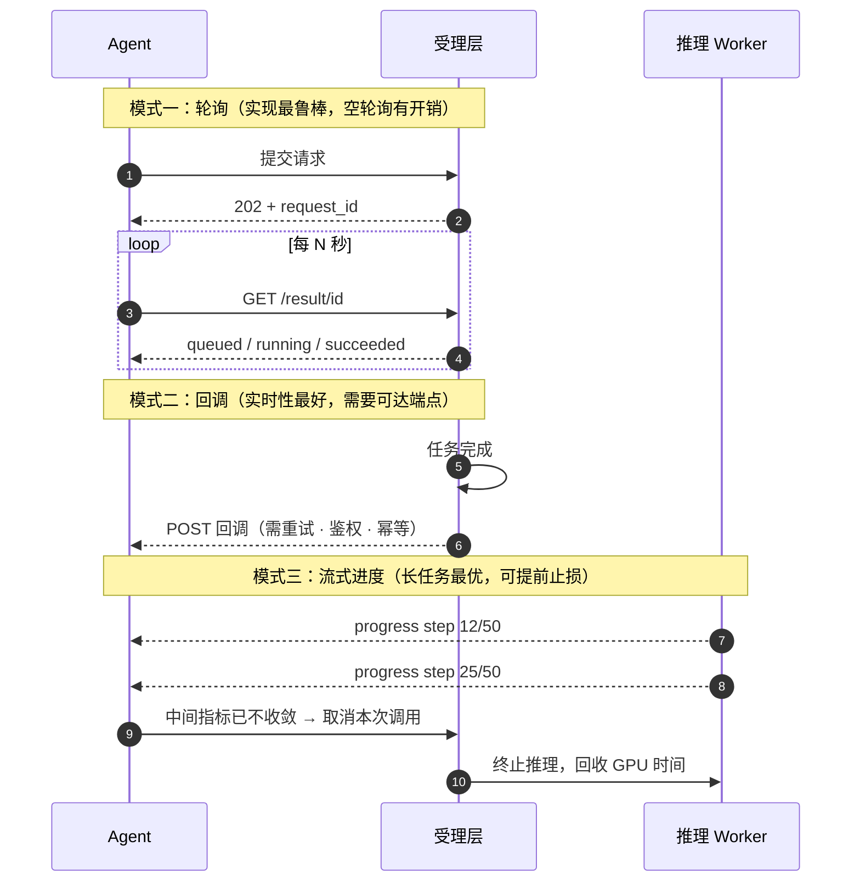
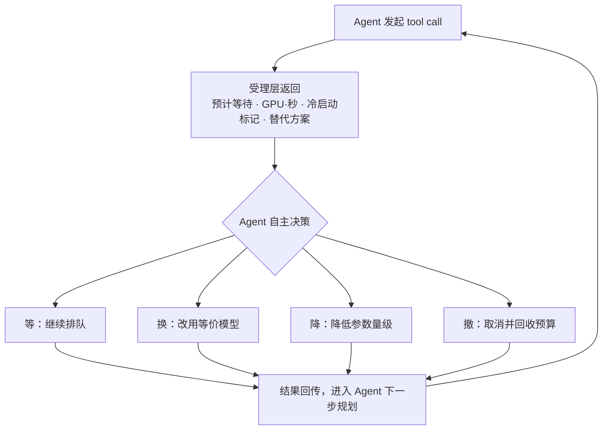
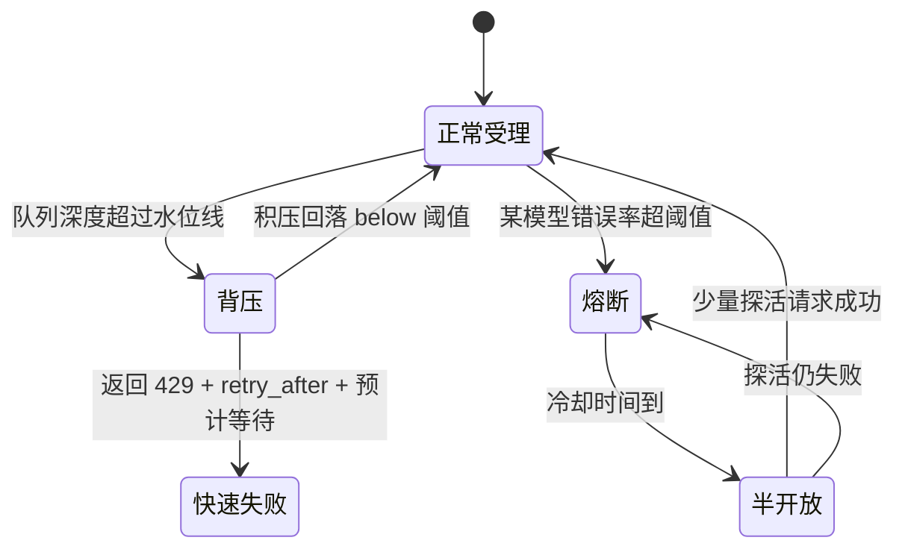
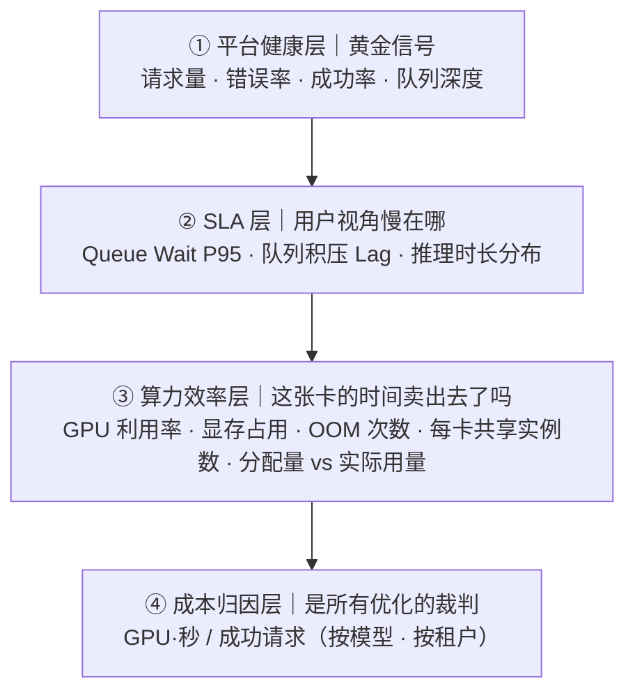

# 有限 GPU 算力下，如何为生命科学 Agent 搭一套推理平台（三）：Agent 协同、可观测性与成本闭环

> **系列导读**：这是系列的第三篇，也是最后一篇。
>
> - **第一篇**：负载的五个结构性特征如何否决掉标准答案，以及架构的四个基本决定。
> - **第二篇**：为什么是"消息队列 + 积压驱动弹性 + GPU 虚拟化"这套组合，以及三大核心矛盾的取舍。
> - **第三篇（本文）**：平台与 Agent 之间究竟靠什么契约对话，怎么保证 Agent 不会把自己的平台打垮，以及怎么度量这套系统到底有没有真的变好。
>
> **关于图表**：文中图表以 Mermaid 源码内嵌，GitHub / 掘金 / 知乎等平台可直接渲染；若发布到不支持 Mermaid 的渠道（如公众号），可用 `figures/` 目录下的同名 PNG / SVG。


---

前两篇我们一直在处理平台的"内部问题"：怎么排队、怎么扩容、怎么分卡。但整套架构里有一个角色始终被当作背景板——**调用它的那个 Agent**。

这一篇要讲的是我认为最被低估的部分。在 GPU 昂贵的场景里，**平台的真正上限不在资源层，而在它与调用方之间的契约层**：你能否让 Agent 知道"这次调用要等多久、要烧多少钱、失败了有没有别的选择"。一个只能被动接受请求的平台，和一个能参与决策的平台，在同等算力下的产出可能相差数倍。

## 一、工具契约：四个字段定生死

受理层返回的 `202 + request_id` 看似简单，但请求里有几个字段不是实现细节，而是**平台与 Agent 之间的协议**：

| 字段                | 作用   | 为什么必须由调用方或平台显式约定                                     |
| ----------------- | ---- | ---------------------------------------------------- |
| `request_id`      | 幂等键  | Agent 重试时必须携带同一个 id，平台才知道"这是同一次调用"，从而不重复消耗 GPU       |
| `deadline_ts`     | 截止时间 | 超过这个时间，Agent 已经放弃或已改道，**平台继续算就是纯浪费**。这是整个系统里最省钱的一个字段 |
| `priority`        | 优先级  | 交互式 tool call 与后台批量扫描必须分轨，否则批量任务会淹没交互请求              |
| `callback` / 轮询方式 | 结果通道 | 决定 Agent 用什么姿势等结果                                    |

为什么强调这些是"契约"：因为它们把**平台的不确定性显式化了**。很多团队把这类语义藏在 SDK 内部，Agent 完全不知道一次调用处于什么状态，于是只能靠超时和重试来兜底——而在一个任务可能跑 15 分钟的系统里，超时 + 重试是最昂贵的行为。

## 二、结果怎么回：三种通道，各有适用

| 通道              | 适用             | 代价与注意事项                                                     |
| --------------- | -------------- | ----------------------------------------------------------- |
| **回调（Webhook）** | 长任务、结果实时性要求高   | Agent 需要有可被访问的地址；回调本身也要重试、鉴权与幂等；回调失败不能导致结果丢失（需要有可回查的结果存储兜底） |
| **轮询**          | 短任务、低频调用、简单客户端 | 实现最鲁棒；代价是空轮询带来的无效请求，需要限制轮询频率并支持长轮询                          |
| **流式进度**        | 分钟级以上的长任务      | 体验最优，**且能解锁一个被忽视的能力：提前止损**                                  |

关于流式进度值得多说一句。RFDiffusion 一次跑 50 步扩散，如果平台能持续回传 `step 12/50`、`step 25/50`，带来的不只是"看着安心"：



- **Agent 可以做早停决策**——看到中间指标已经明显不收敛，直接取消这次调用，把 GPU 时间让给下一条候选；
- **可以对失控任务做预算熔断**——超过预计时长仍在跑，说明输入可能有问题（比如序列长度异常），与其等它跑完，不如今早失败并让 Agent 换个参数；
- **上层可以让用户看到真实进度**，而不是一个转圈的 loading。

在一个每次调用都可能消耗十几分钟 GPU 时间的系统里，**"能看到中间结果"本身就是省钱手段**。

另外一个必须遵守的工程原则是：**大文件不进消息通道**。结构预测产物（CIF / PDB / 轨迹）动辄几十 MB 到 GB 级，消息系统有单条消息体积上限，硬塞会直接失败，也会把缓冲层的吞吐打崩。正解是结果落对象存储，消息里只回传引用地址 + 摘要指标（如 pLDDT / PAE / 打分）。

## 三、让 Agent 有"算力意识"：这套架构最反直觉的一步

这是本篇的核心观点。

传统服务设计里有一条铁律：不要在响应里暴露内部状态。但在 Agent 平台里，**恰恰相反——你越让 Agent 了解算力状态，整个系统的产出越高**。

原因是：Agent 是唯一有"决策权"的角色。它知道这个候选值不值得算下去、这批设计要不要全跑、能不能换个更便宜的模型。平台把这些可能性隐藏起来，等于替 Agent 放弃掉了所有选择。

平台给出状态 → Agent 做出选择 → 结果回到规划链路，**形成一条闭环**：



具体要暴露三类信息：

### 1. 预计等待时间（最重要的一个）

用排队论里最朴素的关系即可估算。设当前某模型队列积压 **L** 条，当前有效并发副本数 **C**，单任务平均耗时 **t**：

```text
预计等待 ≈ (L × t) / C        （副本已就绪的情况）

若当前副本为 0：
预计等待 ≈ 调度时间 + 冷启动时间 + t
```

这个数字直接告诉 Agent：**"这个工具现在不吃紧，前面还有 3 个，约 90 秒后轮到你"**，或者 **"现在是冷启动，约需 2 分钟"**。

有了它，Agent 的行为会发生质变：原本它在 60 秒超时后必然重试，现在它可以判断"再等 90 秒是划算的"，或者"这条链路太长，先做别的分支"。**把不可见的等待变成可见的等待，是消除重试风暴最有效的办法**——没有之一。

### 2. 成本可见

在返回结构里带上本次调用的 `gpu_type`、`gpu_seconds`、`cold_start: true/false`。这样：

- Agent 会话结束时可以生成一份算力账单，知道自己这次跑了多少 GPU 时间；
- 上层可以做预算控制（"这次任务最多用 4 张卡 × 2 小时"）；
- **更重要的是形成反馈**：Agent（或其开发者）会逐渐知道"RFDiffusion 生成 8 个候选约等于 X GPU·分钟"，从而在规划阶段就更克制。

一个不知道自己花了多少钱的执行者，永远学不会节省。

### 3. 降级建议与替代方案

当某个模型排队过久或持续失败时，返回结构里带上建议：**"Protenix 当前排队较久，Boltz-2 可用且功能相近，是否切换？"**

在多模型做同类任务的生命科学场景中，这几乎是免费的可用性提升。同类结构预测模型（Protenix / Boltz-2 / OpenFold3 侧重点不同但任务可替代）让"换模型"成为一条现实的自治路径。

更进一步，平台甚至可以提供**参数级建议**："当前算力紧张，将 `num_designs` 从 8 降到 4 可节省约一半时间，是否接受？" 这需要平台侧把每个模型的参数-成本关系做成一张表——而这正是下一篇要讲的"模型准入规范"的一部分。

**总结一下这一步的回报**：预计等待让 Agent 学会等待，成本可见让 Agent 学会克制，降级建议让 Agent 学会绕行。这三件事加起来的收益，往往大于资源层再优化几个百分点。

## 四、别让 Agent 把自己的平台打垮

前面给 Agent 更多权力，这里就要谈它对等的约束。在一个资源稀缺的系统里，**调用方的错误行为的破坏力被放大了数十倍**（因为每次误调用的代价是十几分钟 GPU）。

### 幂等不是给管家看的，是给 Agent 重试兜底的

第二篇讲过幂等机制。它的价值在 Agent 场景里体现得最直接：**Agent 重试同一个 request_id，不产生第二次 GPU 消耗**。这让上层可以放心地用"乐观重试"策略，而不必担心算力雪崩。

但反过来，**缺少幂等的代价也是灾难性的**：Agent 因为网络抖动重试一次，后台就真的重跑一遍 15 分钟的扩散采样，重复三次就等于三倍账单。

### 重试风暴与背压

即便有幂等，重试风暴依然危险——大量并发重试会同时堆积到队列，把 Lag 推高，触发扩容，然后更多副本冷启动…… 治理手段是三层：

1. **服务端明确告知退避**：返回 `retry_after`，禁止 Agent 用固定间隔猛重试；建议在服务端返回的基础上叠加指数退避 + 随机抖动。
2. **熔断**：某模型错误率超过阈值时直接快速失败一段时间，避免持续消耗。这在共享 GPU 场景下尤其重要——一个持续崩溃的模型会拖累同节点的所有租户。
3. **准入背压（最重要的一层）**：队列深度设水位线，超阈值直接返回 429 + 预计等待。原则是**在入口就拦住过载，而不是让缓冲层无限堆积**。



我倾向于把这张状态图理解为平台的"自我保护机制"：宁可在入口明确拒绝并给出等待 建议，也不要让大家在无声排队里耗尽耐心和 GPU。

第 3 点容易被误认为"对用户不友好"，但恰恰相反：**告诉调用方"现在排不下，预计 X 秒后再来"，比让它提交后默默排队 20 分钟更友好**。前提是你得能给出那个 X。

### 租户配额与优先级

最后是治理维度：按租户设并发与配额上限，防止某个 Agent 会话独占整个 GPU 池；同一模型内部再按优先级分轨（交互式走高优先级，批量扫描走低优先级），保证交互请求的等待时间不被后台任务淹没。资源紧张时，优先保障高优先级与关键租户。

## 五、可观测性：分四层，别只看"有没有挂"

弹性架构跑起来之后，最大的风险就从"架构不对"变成"不知道哪里不对"。我们把指标分成四层，从上到下分别是"系统活着吗"到"钱花得值吗"：



| 层次               | 核心指标                                            | 回答什么问题                |
| ---------------- | ----------------------------------------------- | --------------------- |
| **① 平台健康**（黄金信号） | 请求量、错误率、成功率、队列深度                                | 系统现在活着吗？有没有大规模失败      |
| **② SLA 层**      | **Queue Wait Time**（P50/P95/P99）、积压（Lag）、推理时长分布 | 用户视角慢在哪？是排队慢还是算得慢？    |
| **③ 算力效率层**      | GPU 利用率、显存占用、OOM 次数、每卡共享实例数、整卡利用率               | 这张卡的时间卖出去了吗？切分配额合不合理？ |
| **④ 成本归因层**      | **GPU·秒 / 成功请求**（按模型、按租户）                       | 单位产出花了多少钱？优化有没有真的省钱？  |

几个值得强调的判断：

**Queue Wait Time 是本架构的第一 SLA 指标。** 它直接从"入队"量到"开始推理"，反映的是算力到底够不够。推理时长本身由模型决定，平台能优化的空间有限；但排队时间 100% 是平台的责任。把这两者分开度量，才能分清"模型慢"和"算力不够"。

**第 ③ 层里要区分"分配量"与"实际使用量"。** 一个申请了 24GB 配额的实例，实际峰值可能只用 15GB。看配额会得出"卡满了"的结论，看实际使用会发现还有 30% 空间——这是持续压榨利用率的入口。

**第 ④ 层是所有优化能否成立的裁判。** 没有单位成本指标，"利用率提升了 15%"只是感觉，不是事实。而且成本必须**按模型、按租户归因**：否则你会发现总利用率好看，但某个模型在偷偷烧掉一半预算而你无从下手。

另外，在 Agent 平台上有一个传统服务没有的需求：**全链路追踪必须跨越 LLM 与 GPU 两个世界**。一个 `trace_id` 要从"Agent 第 N 步规划"一路贯穿到"这张卡上的这次推理"，否则当一次会话失败时，你根本回答不了"是模型规划错了、工具选错了、还是这次推理 OOM 了"——而这类归因问题在 Agent 排障里占比极高。

告警上建议至少覆盖：Queue Wait P95 持续超阈值、积压持续增长超过 N 分钟、死信队列新增、单模型成功率跌破阈值、某节点显存长期满载（说明该补卡或调整切分）、扩缩容事件过于频繁（说明阈值抖动，弹性策略在打摆子）。

## 六、让系统自己变好：闭环机制

最后讲讲这套系统怎么随时间改进，而不是上线即巅峰。

### 模型准入规范（刚性要求）

一个新模型要接入平台，必须先提供五项数据，否则我们无法为它配置任何东西：

| 指标                  | 为什么必须         |
| ------------------- | ------------- |
| 显存峰值（实测）            | 决定能切分共享还是必须整卡 |
| 算力需求与利用率形态          | 决定算力配额与是否可共享  |
| 单次耗时分布（P50/P95/P99） | 决定扩缩容阈值与所属泳道  |
| 可否批处理、最小/最优 batch   | 决定能否启用动态批处理   |
| 冷启动耗时               | 决定能否缩到零       |

这条规范的价值在于：**它把"拍脑袋配置"变成了"按数据配置"**。绝大多数弹性失效的根因，都不是框架不好用，而是参数没依据。

### 参数标定表

有了准入数据，再叠加真实流量，就能为每个模型拉出一张标定表（第二篇的冷启动/常驻决策与切分配比，都需要这张表作为输入）：

```text
模型  ×  调用频次  ×  冷启动耗时  ×  单次 GPU 耗时  ×  显存峰值  ×  算力需求
        →  弹性策略（是否缩零、积压阈值、副本上下限）
        →  GPU 策略（整卡 / 共享、显存配额、算力配额）
        →  泳道归属（在线 / 长任务 / 离线旁路）
```

### 演练与复盘

- **混沌验证**：主动杀 Pod、杀节点、制造队列抖动，验证任务不丢且能恢复。这套架构的可靠性主张（"允许重复计算，不允许丢任务"）必须用故障演练来证明，而不是靠推理。
- **周度参数复盘**：看排队 P95、扩缩容频率、GPU 利用率，微调阈值与配额。
- **月度容量评审**：按模型增长趋势调整 GPU 池划分。
- **故障归因沉淀**：每次因缩容或驱逐导致的任务失败，都回溯到具体原因（宽限期不足？阈值过激？配额偏小？缺少幂等？），并把结论固化进配置模板。

### 演进路线（简要）

- **稳定期（0~1 个月）**：链路跑通 + 混沌验证 + 基础看板，验收标准是"任意时刻杀 Pod 都不丢任务"；
- **降本期（1~3 个月）**：标定全部模型的弹性与 GPU 切分参数，上线结果缓存、优先级队列与准入背压，建立单位成本看板；
- **智能期（3~6 个月+）**：把排队深度与预计等待暴露给 Agent 做自主决策；大规模批量任务走离线旁路（Argo Workflows 等）不占在线配额；探索基于历史流量的预测式扩容，以及用竞价实例承载低优先级任务。

注意这条路线是**收敛顺序**的：先保证不丢，再保证省钱，最后才是让 Agent 变聪明。顺序反了会非常痛苦——一个会把 Agent 决策搞崩的平台，省再多钱也没意义。

## 七、系列总结

回到开篇那个问题：GPU 有限，上层是一个会自主规划、批量调用工具的生命科学 Agent，中间的推理层该怎么搭。

我们的答案可以收拢成一句话：

> **用在线服务的方式受理请求，用批处理系统的方式调度任务，用虚拟化的方式榨取每张卡的剩余价值，并且把算力的真实状态（等待多久、花多少钱、有没有更便宜的选择）诚实地告诉调用方。**

具体到四个基本决定：**受理与执行解耦**（异步化不是优化，是前提）、**按模型隔离队列**（ blast radius 与差异化策略的基础）、**积压驱动弹性**（唯一既能反映真实负载又能缩到零的信号）、**弹性层与资源层正交**（不要让一个组件同时回答"要几个实例"和"实例放哪张卡"）。

以及三个贯穿始终的取舍原则：**允许重复计算但不允许丢任务**；**让错误在消耗算力之前暴露**；**把成本归因到单次调用，否则一切优化无从验证**。

最后想说的一点：这套模式的适用边界并不局限于生命科学。任何一&#x4E2A;**"AI 规划器 + 昂贵垂类执行器"**（Agent 调用 GPU 密集型工具）的场景，都会长出类似的形态——科学计算、多模态生成、机器人仿真、 CAD/EDA 自动设计。**只要存在"单次执行贵到不能失败、任务时长跨越数量级、调用方自主决策"这三个条件，这套架构逻辑基本就是成立的。**

希望这个系列对同样在算力约束下做 AI 平台的团队有参考价值。
